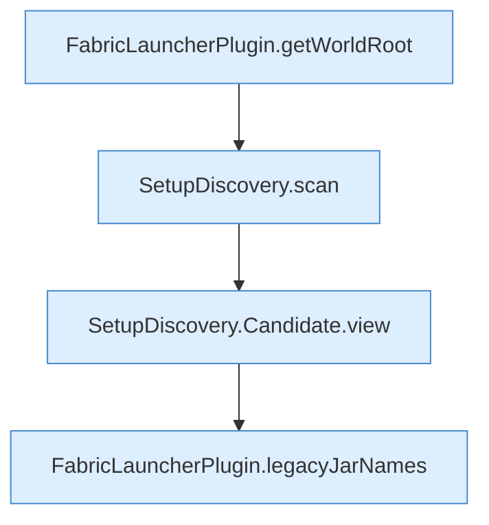

[[00 Start]] › [[Plugin-Kern]] › [[Setup]] › [[Setup-Dialog]] › [[FabricLauncherPlugin.setupView]] › [[FabricLauncherPlugin.setupView.Teil1]]

# FabricLauncherPlugin.setupView.Teil1



```knoten
FabricLauncherPlugin.getWorldRoot
  Liefert `getWorldRoot`.
SetupDiscovery.scan
  Durchsucht `scan`. Ruft `legacyPluginVersion`, `isAtLeast`, `loadLegacyConfig`.
SetupDiscovery.Candidate.view
  Liefert die Sicht `view`.
FabricLauncherPlugin.legacyJarNames
  `legacyJarNames` in `FabricLauncherPlugin.java`.
```

- Fortsetzung von `FabricLauncherPlugin.setupView`, Quellreihenfolge.
