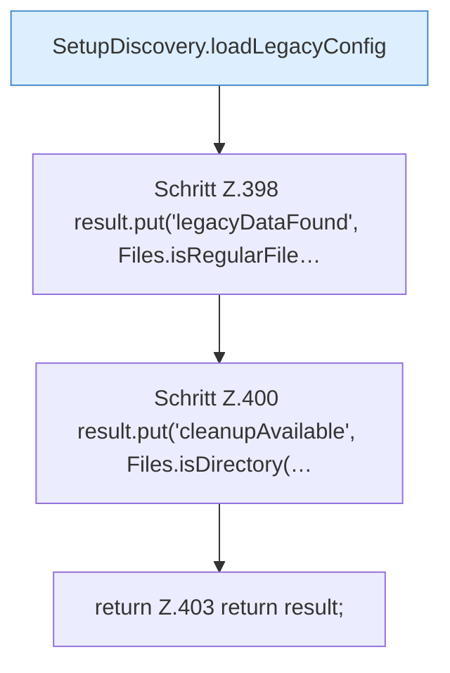

[[00 Start]] › [[Plugin-Kern]] › [[Setup]] › [[Setup-Dialog]] › [[FabricLauncherPlugin.setupView]] › [[FabricLauncherPlugin.setupView.Teil2]]

# FabricLauncherPlugin.setupView.Teil2



```knoten
SetupDiscovery.loadLegacyConfig
  Dieser Teil lädt den alten Weg die [[Glossar#Einstellungen|Einstellungen]]. Lädt `loadLegacyConfig`.
Schritt Z.398 result.put('legacyDataFound', Files.isRegularFile…
  Zeile 398: Dateioperation. `result.put('legacyDataFound', Files.isRegularFile…`
Schritt Z.400 result.put('cleanupAvailable', Files.isDirectory(…
  Zeile 400: Dateioperation. `result.put('cleanupAvailable', Files.isDirectory(…`
return Z.403 return result;
  Zeile 403: Rückgabe `return result;`.
```

> [!knoten]- Was die Blöcke tun
> - **SetupDiscovery.loadLegacyConfig**: Dieser Teil lädt den alten Weg die [[Glossar#Einstellungen|Einstellungen]]. Lädt `loadLegacyConfig`.
> - **Schritt Z.398 result.put('legacyDataFound', Files.isRegularFile…**: Zeile 398: Dateioperation. `result.put('legacyDataFound', Files.isRegularFile…`
> - **Schritt Z.400 result.put('cleanupAvailable', Files.isDirectory(…**: Zeile 400: Dateioperation. `result.put('cleanupAvailable', Files.isDirectory(…`
> - **return Z.403 return result;**: Zeile 403: Rückgabe `return result;`.

- Ein weiterer Abschnitt derselben Übersicht.
- Fortsetzung von `FabricLauncherPlugin.setupView`.
