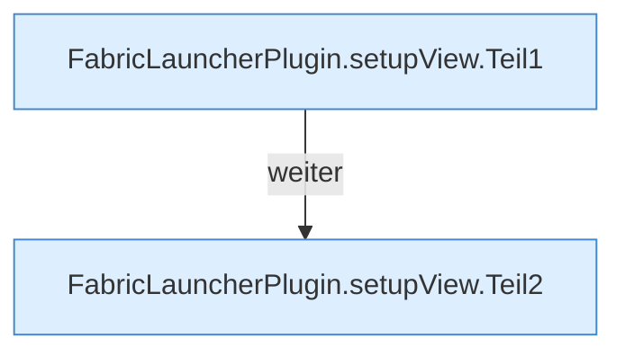

[[00 Start]] › [[Plugin-Kern]] › [[Setup]] › [[Setup-Dialog]] › [[FabricLauncherPlugin.setupView]]

# FabricLauncherPlugin.setupView

`FabricLauncherPlugin.setupView()` [src/main/java/de/aichele/childlauncher/FabricLauncherPlugin.java:380–404](https://github.com/Sciddie/minecraft-serverhoster-plugin/blob/95b02b953b0b4c23673e900e021a7c3c844aa37d/src/main/java/de/aichele/childlauncher/FabricLauncherPlugin.java#L380-L404)



```knoten
FabricLauncherPlugin.setupView.Teil1
  Abschnitt 1 dieses Ablaufs, in Quellreihenfolge.
FabricLauncherPlugin.setupView.Teil2
  Abschnitt 2 dieses Ablaufs, in Quellreihenfolge.
```

- `setupView` in `src/main/java/de/aichele/childlauncher/FabricLauncherPlugin.java`
