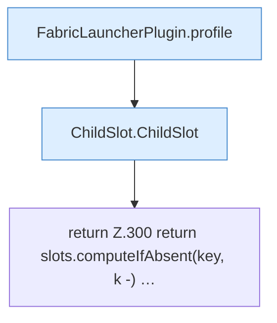

[[00 Start]] › [[Plugin-Kern]] › [[Fokus]] › [[FabricLauncherPlugin.slot]]

# FabricLauncherPlugin.slot

`FabricLauncherPlugin.slot(String id)` [src/main/java/de/aichele/childlauncher/FabricLauncherPlugin.java:297–301](https://github.com/Sciddie/minecraft-serverhoster-plugin/blob/95b02b953b0b4c23673e900e021a7c3c844aa37d/src/main/java/de/aichele/childlauncher/FabricLauncherPlugin.java#L297-L301)



```knoten
FabricLauncherPlugin.profile
  Das [[Glossar#Plugin|Plugin]] macht hier einen einzelnen Schritt. Eine Ebene tiefer steht er genauer. Im [[Glossar#Quelltext|Quelltext]] heißt das `profile`.
ChildSlot.ChildSlot
  Dieser Teil kümmert sich um den [[Glossar#Platz|Platz]]. Im [[Glossar#Quelltext|Quelltext]] heißt das `ChildSlot`.
return Z.300 return slots.computeIfAbsent(key, k -) …
  Hier endet die [[Glossar#Funktion|Funktion]] und liefert ein Ergebnis zurück. Das steht in [[Glossar#Zeile|Zeile]] 300.
```

> [!knoten]- Was die Blöcke tun
> - **FabricLauncherPlugin.profile**: Das [[Glossar#Plugin|Plugin]] macht hier einen einzelnen Schritt. Eine Ebene tiefer steht er genauer. Im [[Glossar#Quelltext|Quelltext]] heißt das `profile`.
> - **ChildSlot.ChildSlot**: Dieser Teil kümmert sich um den [[Glossar#Platz|Platz]]. Im [[Glossar#Quelltext|Quelltext]] heißt das `ChildSlot`.
> - **return Z.300 return slots.computeIfAbsent(key, k -) …**: Hier endet die [[Glossar#Funktion|Funktion]] und liefert ein Ergebnis zurück. Das steht in [[Glossar#Zeile|Zeile]] 300.

- Das [[Glossar#Plugin|Plugin]] macht hier einen einzelnen Schritt. Eine Ebene tiefer steht er genauer.
