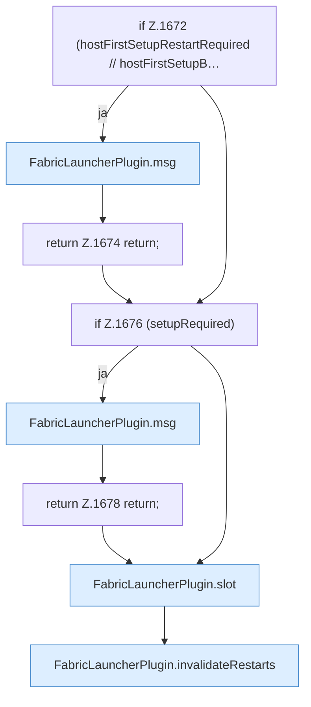

[[00 Start]] › [[Child-Prozess]] › [[Startablauf]] › [[FabricLauncherPlugin.startAsync]] › [[FabricLauncherPlugin.startAsync.Teil1]]

# FabricLauncherPlugin.startAsync.Teil1

- Fortsetzung von `FabricLauncherPlugin.startAsync`, Quellreihenfolge.
