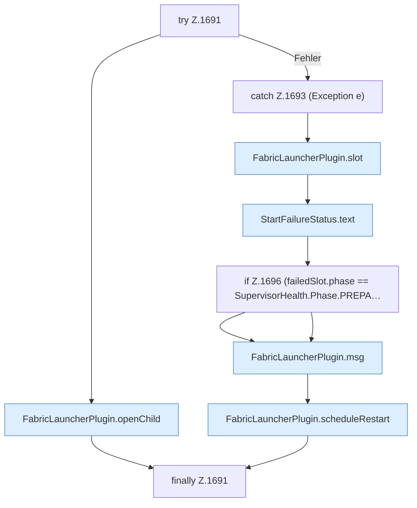

[[00 Start]] › [[Child-Prozess]] › [[Startablauf]] › [[FabricLauncherPlugin.startAsync]] › [[FabricLauncherPlugin.startAsync.Teil2.Z1689.Z1690.Z1691]]

# FabricLauncherPlugin.startAsync.Teil2.Z1689.Z1690.Z1691



```knoten
try Z.1691
  Zeile 1691: Versuch. Der Fehlerpfad geht in catch.
FabricLauncherPlugin.openChild
  Prüft, ob der [[Glossar#Platz|Platz]] frei ist, und gibt den Start dann weiter. Läuft er schon, passiert nichts. Öffnet `openChild`. Ruft `slot`, `running`, `msg`.
catch Z.1693 (Exception e)
  Zeile 1693: fängt (Exception e).
FabricLauncherPlugin.slot
  Das [[Glossar#Plugin|Plugin]] macht hier einen einzelnen Schritt. Eine Ebene tiefer steht er genauer. `slot` in `FabricLauncherPlugin.java`. Ruft `profile`, `ChildSlot`.
StartFailureStatus.text
  Dieser Teil macht hier einen einzelnen Schritt. Eine Ebene tiefer steht er genauer. Antwortet mit Text `text`.
if Z.1696 (failedSlot.phase == SupervisorHealth.Phase.PREPA…
  Zeile 1696: prüft `(failedSlot.phase == SupervisorHealth.Phase.PREPA…`.
FabricLauncherPlugin.msg
  Schickt eine [[Glossar#Zeile|Zeile]] an den Menschen, der einen [[Glossar#Befehl|Befehl]] getippt hat. Sendet eine Chat-Zeile `msg`.
FabricLauncherPlugin.scheduleRestart
  Wartet die [[Glossar#Pause|Pause]] und startet den [[Glossar#Spielserver|Spielserver]] dann neu. Am Anfang sind das fünf Sekunden, höchstens fünf Minuten. Plant `scheduleRestart`. Ruft `maxAttempts`, `mayRetry`, `notifyNtfy`.
finally Z.1691
  Läuft danach immer, auch nach einem Fehler.
```

> [!knoten]- Was die Blöcke tun
> - **try Z.1691**: Zeile 1691: Versuch. Der Fehlerpfad geht in catch.
> - **FabricLauncherPlugin.openChild**: Prüft, ob der [[Glossar#Platz|Platz]] frei ist, und gibt den Start dann weiter. Läuft er schon, passiert nichts. Öffnet `openChild`. Ruft `slot`, `running`, `msg`.
> - **catch Z.1693 (Exception e)**: Zeile 1693: fängt (Exception e).
> - **FabricLauncherPlugin.slot**: Das [[Glossar#Plugin|Plugin]] macht hier einen einzelnen Schritt. Eine Ebene tiefer steht er genauer. `slot` in `FabricLauncherPlugin.java`. Ruft `profile`, `ChildSlot`.
> - **StartFailureStatus.text**: Dieser Teil macht hier einen einzelnen Schritt. Eine Ebene tiefer steht er genauer. Antwortet mit Text `text`.
> - **if Z.1696 (failedSlot.phase == SupervisorHealth.Phase.PREPA…**: Zeile 1696: prüft `(failedSlot.phase == SupervisorHealth.Phase.PREPA…`.
> - **FabricLauncherPlugin.msg**: Schickt eine [[Glossar#Zeile|Zeile]] an den Menschen, der einen [[Glossar#Befehl|Befehl]] getippt hat. Sendet eine Chat-Zeile `msg`.
> - **FabricLauncherPlugin.scheduleRestart**: Wartet die [[Glossar#Pause|Pause]] und startet den [[Glossar#Spielserver|Spielserver]] dann neu. Am Anfang sind das fünf Sekunden, höchstens fünf Minuten. Plant `scheduleRestart`. Ruft `maxAttempts`, `mayRetry`, `notifyNtfy`.
> - **finally Z.1691**: Läuft danach immer, auch nach einem Fehler.

- Der Ablauf geht in [[Glossar#Zeile|Zeile]] 1691 weiter. Eine Ebene tiefer steht er genauer.
- Fortsetzung von `FabricLauncherPlugin.startAsync.Teil2.Z1689.Z1690`.
