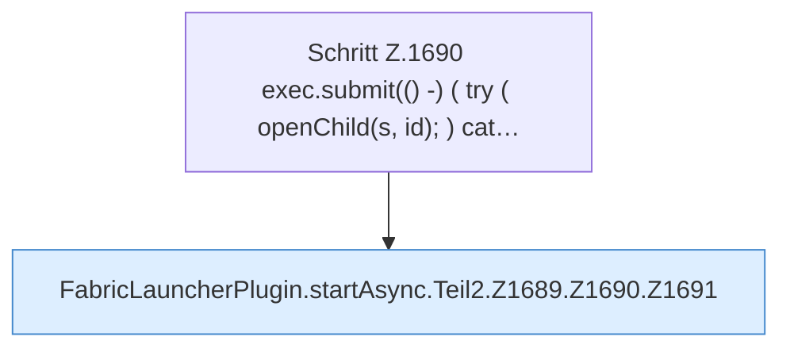

[[00 Start]] › [[Child-Prozess]] › [[Startablauf]] › [[FabricLauncherPlugin.startAsync]] › [[FabricLauncherPlugin.startAsync.Teil2.Z1689.Z1690]]

# FabricLauncherPlugin.startAsync.Teil2.Z1689.Z1690



```knoten
Schritt Z.1690 exec.submit(() -) ( try ( openChild(s, id); ) cat…
  Zeile 1690: legt die Arbeit auf den Pool ServerhosterPlugin. `exec.submit(() -) ( try ( openChild(s, id); ) cat…`
FabricLauncherPlugin.startAsync.Teil2.Z1689.Z1690.Z1691
  Der Ablauf geht in [[Glossar#Zeile|Zeile]] 1691 weiter. Eine Ebene tiefer steht er genauer. Fortsetzung des Ablaufs ab Zeile 1691.
```

> [!knoten]- Was die Blöcke tun
> - **Schritt Z.1690 exec.submit(() -) ( try ( openChild(s, id); ) cat…**: Zeile 1690: legt die Arbeit auf den Pool ServerhosterPlugin. `exec.submit(() -) ( try ( openChild(s, id); ) cat…`
> - **FabricLauncherPlugin.startAsync.Teil2.Z1689.Z1690.Z1691**: Der Ablauf geht in [[Glossar#Zeile|Zeile]] 1691 weiter. Eine Ebene tiefer steht er genauer. Fortsetzung des Ablaufs ab Zeile 1691.

- Der Ablauf geht in [[Glossar#Zeile|Zeile]] 1690 weiter. Eine Ebene tiefer steht er genauer.
- Fortsetzung von `FabricLauncherPlugin.startAsync.Teil2.Z1689`.
