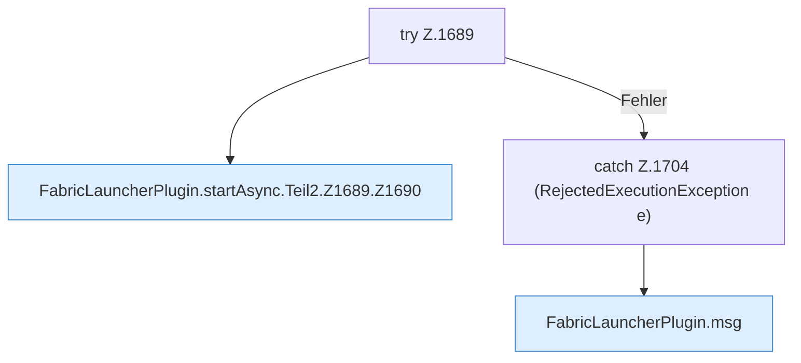

[[00 Start]] › [[Child-Prozess]] › [[Startablauf]] › [[FabricLauncherPlugin.startAsync]] › [[FabricLauncherPlugin.startAsync.Teil2.Z1689]]

# FabricLauncherPlugin.startAsync.Teil2.Z1689



```knoten
try Z.1689
  Zeile 1689: Versuch. Der Fehlerpfad geht in catch.
FabricLauncherPlugin.startAsync.Teil2.Z1689.Z1690
  Fortsetzung des Ablaufs ab Zeile 1690.
catch Z.1704 (RejectedExecutionException e)
  Zeile 1704: fängt (RejectedExecutionException e).
FabricLauncherPlugin.msg
  Sendet eine Chat-Zeile `msg`.
```

- Fortsetzung von `FabricLauncherPlugin.startAsync.Teil2`, Quellreihenfolge.
