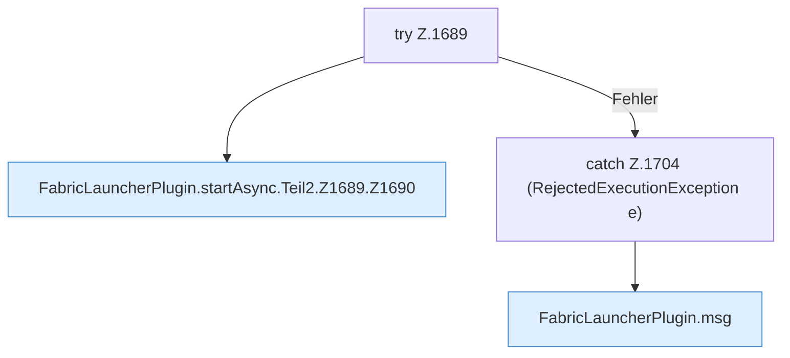

[[00 Start]] › [[Child-Prozess]] › [[Startablauf]] › [[FabricLauncherPlugin.startAsync]] › [[FabricLauncherPlugin.startAsync.Teil2.Z1689]]

# FabricLauncherPlugin.startAsync.Teil2.Z1689



```knoten
try Z.1689
  Zeile 1689: Versuch. Der Fehlerpfad geht in catch.
FabricLauncherPlugin.startAsync.Teil2.Z1689.Z1690
  Der Ablauf geht in [[Glossar#Zeile|Zeile]] 1690 weiter. Eine Ebene tiefer steht er genauer. Fortsetzung des Ablaufs ab Zeile 1690.
catch Z.1704 (RejectedExecutionException e)
  Zeile 1704: fängt (RejectedExecutionException e).
FabricLauncherPlugin.msg
  Schickt eine [[Glossar#Zeile|Zeile]] an den Menschen, der einen [[Glossar#Befehl|Befehl]] getippt hat. Sendet eine Chat-Zeile `msg`.
```

> [!knoten]- Was die Blöcke tun
> - **try Z.1689**: Zeile 1689: Versuch. Der Fehlerpfad geht in catch.
> - **FabricLauncherPlugin.startAsync.Teil2.Z1689.Z1690**: Der Ablauf geht in [[Glossar#Zeile|Zeile]] 1690 weiter. Eine Ebene tiefer steht er genauer. Fortsetzung des Ablaufs ab Zeile 1690.
> - **catch Z.1704 (RejectedExecutionException e)**: Zeile 1704: fängt (RejectedExecutionException e).
> - **FabricLauncherPlugin.msg**: Schickt eine [[Glossar#Zeile|Zeile]] an den Menschen, der einen [[Glossar#Befehl|Befehl]] getippt hat. Sendet eine Chat-Zeile `msg`.

- Der Ablauf geht in [[Glossar#Zeile|Zeile]] 1689 weiter. Eine Ebene tiefer steht er genauer.
- Fortsetzung von `FabricLauncherPlugin.startAsync.Teil2`.
