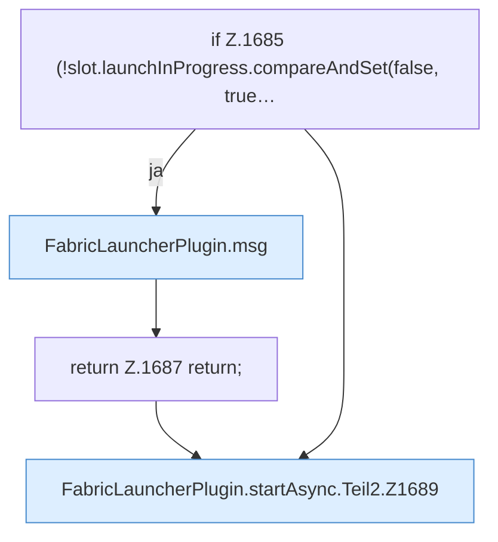

[[00 Start]] › [[Child-Prozess]] › [[Startablauf]] › [[FabricLauncherPlugin.startAsync]] › [[FabricLauncherPlugin.startAsync.Teil2]]

# FabricLauncherPlugin.startAsync.Teil2



```knoten
if Z.1685 (!slot.launchInProgress.compareAndSet(false, true…
  Zeile 1685: prüft `(!slot.launchInProgress.compareAndSet(false, true…`.
FabricLauncherPlugin.msg
  Schickt eine [[Glossar#Zeile|Zeile]] an den Menschen, der einen [[Glossar#Befehl|Befehl]] getippt hat. Sendet eine Chat-Zeile `msg`.
return Z.1687 return;
  Zeile 1687: Rückgabe `return;`.
FabricLauncherPlugin.startAsync.Teil2.Z1689
  Der Ablauf geht in [[Glossar#Zeile|Zeile]] 1689 weiter. Eine Ebene tiefer steht er genauer. Fortsetzung des Ablaufs ab Zeile 1689.
```

> [!knoten]- Was die Blöcke tun
> - **if Z.1685 (!slot.launchInProgress.compareAndSet(false, true…**: Zeile 1685: prüft `(!slot.launchInProgress.compareAndSet(false, true…`.
> - **FabricLauncherPlugin.msg**: Schickt eine [[Glossar#Zeile|Zeile]] an den Menschen, der einen [[Glossar#Befehl|Befehl]] getippt hat. Sendet eine Chat-Zeile `msg`.
> - **return Z.1687 return;**: Zeile 1687: Rückgabe `return;`.
> - **FabricLauncherPlugin.startAsync.Teil2.Z1689**: Der Ablauf geht in [[Glossar#Zeile|Zeile]] 1689 weiter. Eine Ebene tiefer steht er genauer. Fortsetzung des Ablaufs ab Zeile 1689.

- Ein weiterer Abschnitt derselben Übersicht.
- Fortsetzung von `FabricLauncherPlugin.startAsync`.
