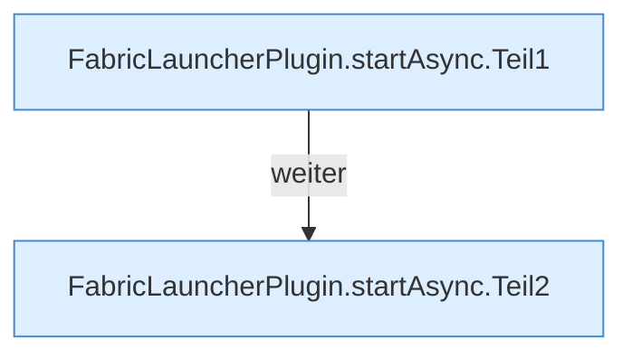

[[00 Start]] › [[Child-Prozess]] › [[Startablauf]] › [[FabricLauncherPlugin.startAsync]]

# FabricLauncherPlugin.startAsync

`FabricLauncherPlugin.startAsync(CommandSender s, String id)` [src/main/java/de/aichele/childlauncher/FabricLauncherPlugin.java:1671–1709](https://github.com/Sciddie/minecraft-serverhoster-plugin/blob/95b02b953b0b4c23673e900e021a7c3c844aa37d/src/main/java/de/aichele/childlauncher/FabricLauncherPlugin.java#L1671-L1709)

- `startAsync` in `src/main/java/de/aichele/childlauncher/FabricLauncherPlugin.java`
