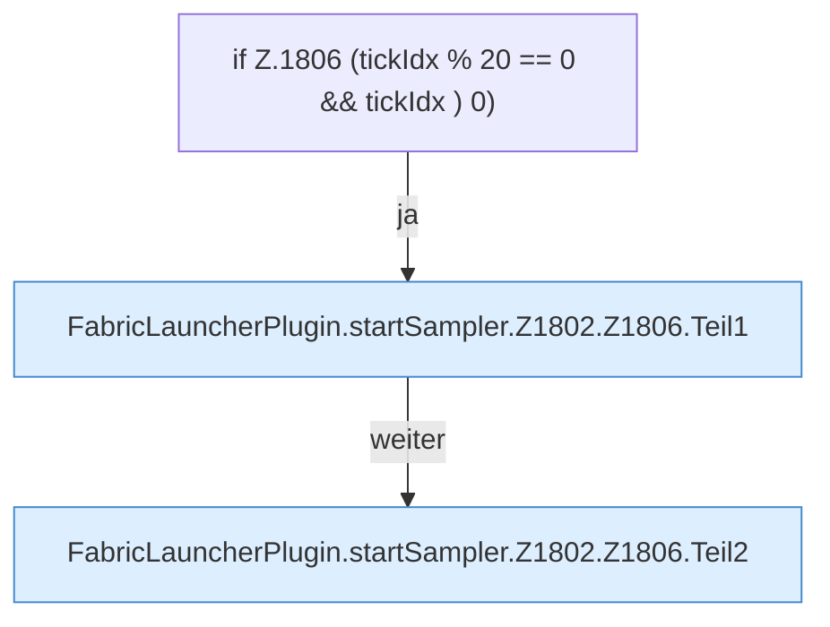

[[00 Start]] › [[Child-Prozess]] › [[Pipe-Watch]] › [[FabricLauncherPlugin.startSampler]] › [[FabricLauncherPlugin.startSampler.Z1802.Z1806]]

# FabricLauncherPlugin.startSampler.Z1802.Z1806



```knoten
if Z.1806 (tickIdx % 20 == 0 && tickIdx ) 0)
  Zeile 1806: prüft `(tickIdx % 20 == 0 && tickIdx ) 0)`.
FabricLauncherPlugin.startSampler.Z1802.Z1806.Teil1
  Abschnitt 1 dieses Ablaufs, in Quellreihenfolge.
FabricLauncherPlugin.startSampler.Z1802.Z1806.Teil2
  Abschnitt 2 dieses Ablaufs, in Quellreihenfolge.
```

- Fortsetzung von `FabricLauncherPlugin.startSampler.Z1802`, Quellreihenfolge.
