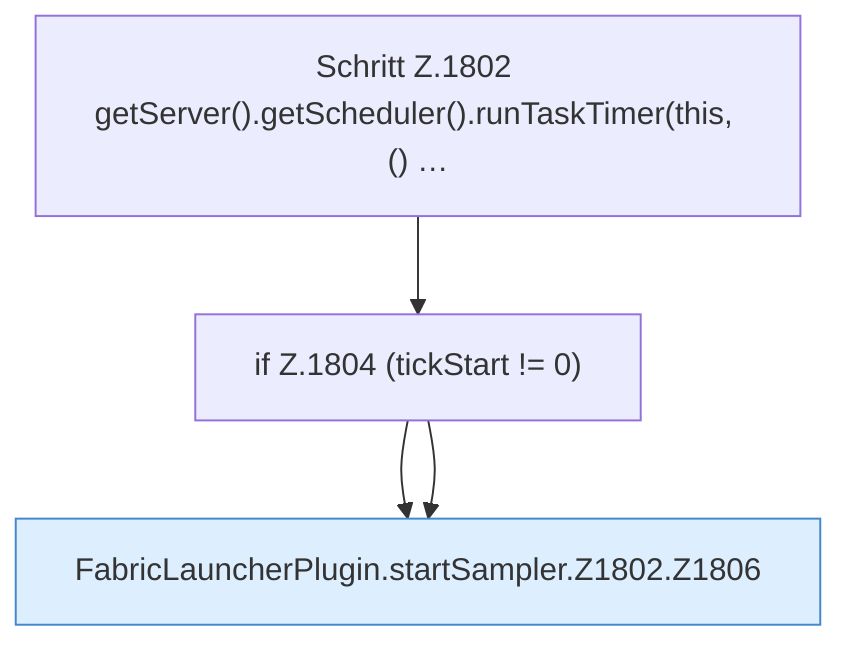

[[00 Start]] › [[Child-Prozess]] › [[Pipe-Watch]] › [[FabricLauncherPlugin.startSampler]] › [[FabricLauncherPlugin.startSampler.Z1802]]

# FabricLauncherPlugin.startSampler.Z1802

- Fortsetzung von `FabricLauncherPlugin.startSampler`, Quellreihenfolge.
