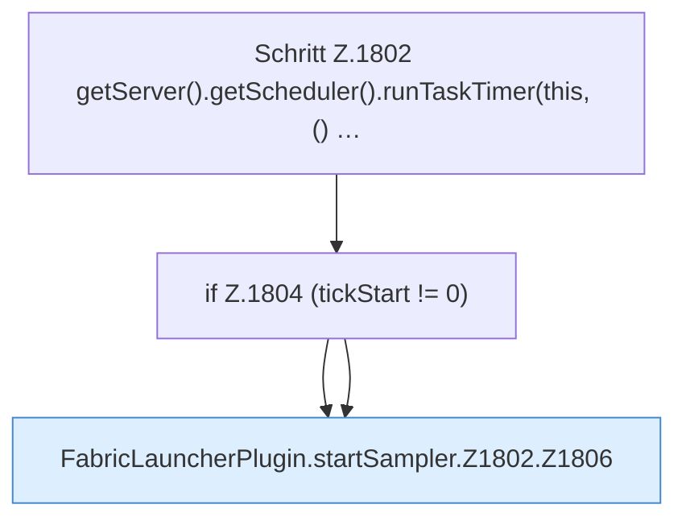

[[00 Start]] › [[Child-Prozess]] › [[Pipe-Watch]] › [[FabricLauncherPlugin.startSampler]] › [[FabricLauncherPlugin.startSampler.Z1802]]

# FabricLauncherPlugin.startSampler.Z1802



```knoten
Schritt Z.1802 getServer().getScheduler().runTaskTimer(this, () …
  Zeile 1802: hängt einen Lauf an den Server-Tick. `getServer().getScheduler().runTaskTimer(this, () …`
if Z.1804 (tickStart != 0)
  Zeile 1804: prüft `(tickStart != 0)`.
FabricLauncherPlugin.startSampler.Z1802.Z1806
  Der Ablauf geht in [[Glossar#Zeile|Zeile]] 1806 weiter. Eine Ebene tiefer steht er genauer. Fortsetzung des Ablaufs ab Zeile 1806.
```

> [!knoten]- Was die Blöcke tun
> - **Schritt Z.1802 getServer().getScheduler().runTaskTimer(this, () …**: Zeile 1802: hängt einen Lauf an den Server-Tick. `getServer().getScheduler().runTaskTimer(this, () …`
> - **if Z.1804 (tickStart != 0)**: Zeile 1804: prüft `(tickStart != 0)`.
> - **FabricLauncherPlugin.startSampler.Z1802.Z1806**: Der Ablauf geht in [[Glossar#Zeile|Zeile]] 1806 weiter. Eine Ebene tiefer steht er genauer. Fortsetzung des Ablaufs ab Zeile 1806.

- Der Ablauf geht in [[Glossar#Zeile|Zeile]] 1802 weiter. Eine Ebene tiefer steht er genauer.
- Fortsetzung von `FabricLauncherPlugin.startSampler`.
