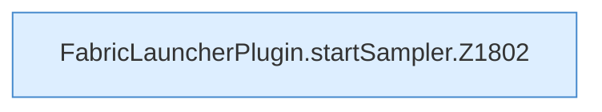
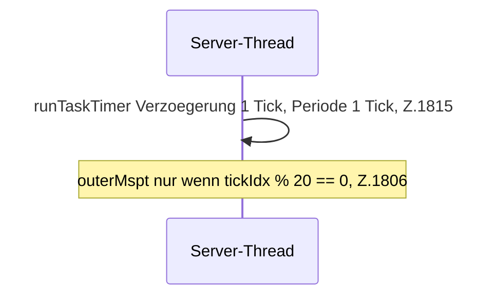

[[00 Start]] › [[Child-Prozess]] › [[Pipe-Watch]] › [[FabricLauncherPlugin.startSampler]]

# FabricLauncherPlugin.startSampler

`FabricLauncherPlugin.startSampler()` [src/main/java/de/aichele/childlauncher/FabricLauncherPlugin.java:1799–1816](https://github.com/Sciddie/minecraft-serverhoster-plugin/blob/95b02b953b0b4c23673e900e021a7c3c844aa37d/src/main/java/de/aichele/childlauncher/FabricLauncherPlugin.java#L1799-L1816)

- Server-Thread, `runTaskTimer` 1 Tick / 1 Tick.
- Befund: Kommentar widerspricht Code, sicher. Feldkommentar Z.66 once per second, runTaskTimer Z.1815 Periode 1 Tick, Schreiben alle 20 Ticks Z.1806
