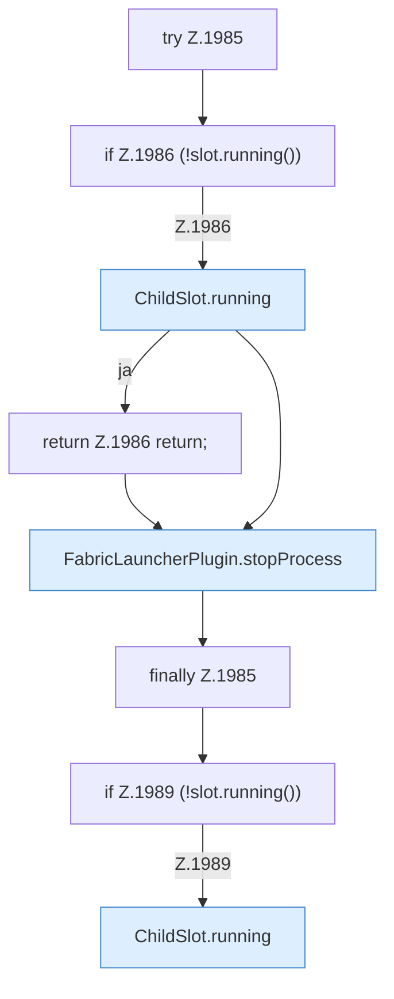

[[00 Start]] › [[Child-Prozess]] › [[Stopp]] › [[FabricLauncherPlugin.stopBlocking]] › [[FabricLauncherPlugin.stopBlocking.Z1985]]

# FabricLauncherPlugin.stopBlocking.Z1985



```knoten
try Z.1985
  Zeile 1985: Versuch. Der Fehlerpfad geht in catch.
if Z.1986 (!slot.running())
  Zeile 1986: prüft `(!slot.running())`.
ChildSlot.running
  Sagt, ob der Prozess läuft `running`.
return Z.1986 return;
  Zeile 1986: Rückgabe `return;`.
FabricLauncherPlugin.stopProcess
  Stoppt `stopProcess`. Ruft `add`, `boundedSeconds`, `warnOnce`.
finally Z.1985
  Läuft danach immer, auch nach einem Fehler.
if Z.1989 (!slot.running())
  Zeile 1989: prüft `(!slot.running())`.
```

- Fortsetzung von `FabricLauncherPlugin.stopBlocking`, Quellreihenfolge.
