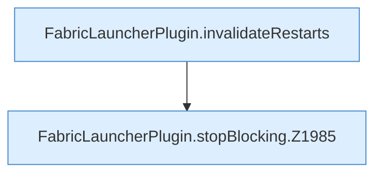

[[00 Start]] › [[Child-Prozess]] › [[Stopp]] › [[FabricLauncherPlugin.stopBlocking]]

# FabricLauncherPlugin.stopBlocking

`FabricLauncherPlugin.stopBlocking(ChildSlot slot)` [src/main/java/de/aichele/childlauncher/FabricLauncherPlugin.java:1980–1991](https://github.com/Sciddie/minecraft-serverhoster-plugin/blob/95b02b953b0b4c23673e900e021a7c3c844aa37d/src/main/java/de/aichele/childlauncher/FabricLauncherPlugin.java#L1980-L1991)

- `stopBlocking` in `src/main/java/de/aichele/childlauncher/FabricLauncherPlugin.java`
