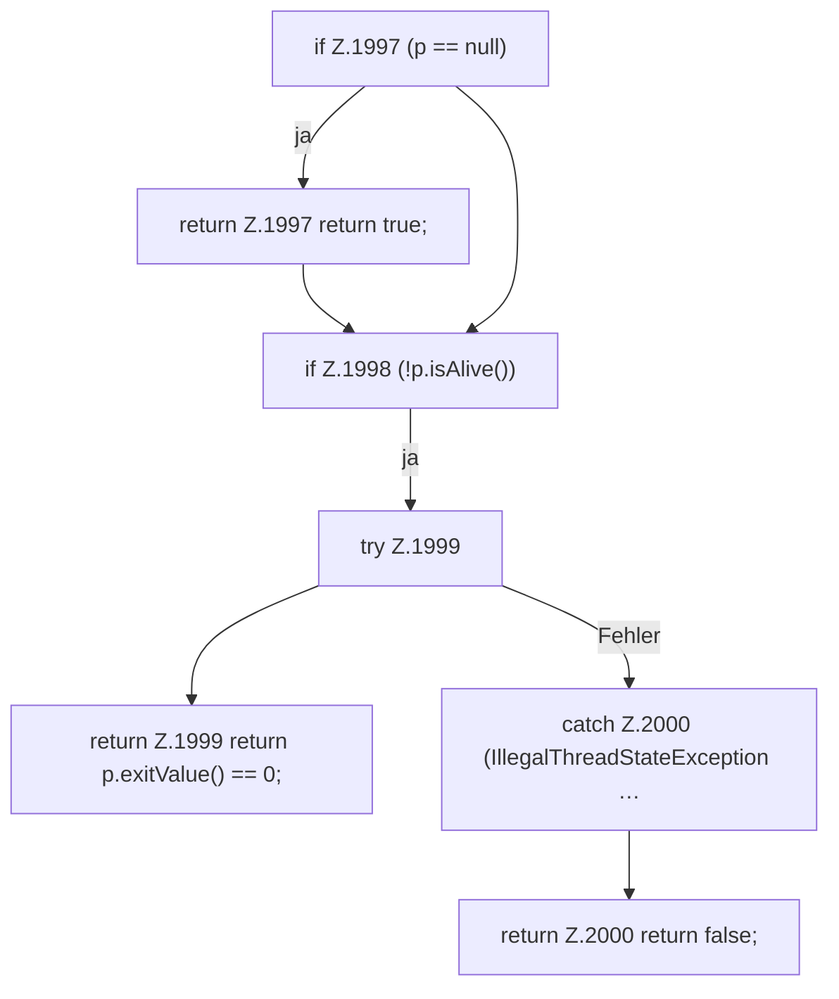

[[00 Start]] › [[Child-Prozess]] › [[Stopp]] › [[FabricLauncherPlugin.stopProcess]] › [[FabricLauncherPlugin.stopProcess.Z1994.Teil1]]

# FabricLauncherPlugin.stopProcess.Z1994.Teil1



```knoten
if Z.1997 (p == null)
  Zeile 1997: prüft `(p == null)`.
return Z.1997 return true;
  Zeile 1997: Rückgabe `return true;`.
if Z.1998 (!p.isAlive())
  Zeile 1998: prüft `(!p.isAlive())`.
try Z.1999
  Zeile 1999: Versuch. Der Fehlerpfad geht in catch.
return Z.1999 return p.exitValue() == 0;
  Zeile 1999: Rückgabe `return p.exitValue() == 0;`.
catch Z.2000 (IllegalThreadStateException …
  Zeile 2000: fängt (IllegalThreadStateException ….
return Z.2000 return false;
  Zeile 2000: Rückgabe `return false;`.
```

> [!knoten]- Was die Blöcke tun
> - **if Z.1997 (p == null)**: Zeile 1997: prüft `(p == null)`.
> - **return Z.1997 return true;**: Zeile 1997: Rückgabe `return true;`.
> - **if Z.1998 (!p.isAlive())**: Zeile 1998: prüft `(!p.isAlive())`.
> - **try Z.1999**: Zeile 1999: Versuch. Der Fehlerpfad geht in catch.
> - **return Z.1999 return p.exitValue() == 0;**: Zeile 1999: Rückgabe `return p.exitValue() == 0;`.
> - **catch Z.2000 (IllegalThreadStateException …**: Zeile 2000: fängt (IllegalThreadStateException ….
> - **return Z.2000 return false;**: Zeile 2000: Rückgabe `return false;`.

- Ein weiterer Abschnitt derselben Übersicht.
- Fortsetzung von `FabricLauncherPlugin.stopProcess.Z1994`.
