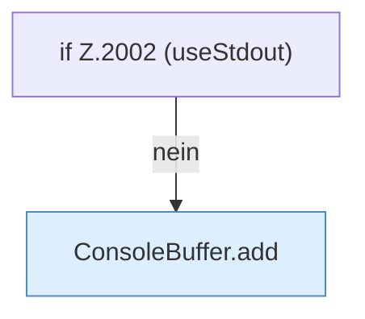

[[00 Start]] › [[Child-Prozess]] › [[Stopp]] › [[FabricLauncherPlugin.stopProcess]] › [[FabricLauncherPlugin.stopProcess.Z1994.Teil2]]

# FabricLauncherPlugin.stopProcess.Z1994.Teil2



```knoten
if Z.2002 (useStdout)
  Zeile 2002: prüft `(useStdout)`.
ConsoleBuffer.add
  Fügt hinzu `add`.
```

- Fortsetzung von `FabricLauncherPlugin.stopProcess.Z1994`, Quellreihenfolge.
