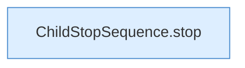

[[00 Start]] › [[Child-Prozess]] › [[Stopp]] › [[FabricLauncherPlugin.stopProcess]] › [[FabricLauncherPlugin.stopProcess.Z1994.Teil3.Z2011]]

# FabricLauncherPlugin.stopProcess.Z1994.Teil3.Z2011



```knoten
ChildStopSequence.stop
  Dieser Teil stoppt das. Stoppt `stop`. Ruft `signal`.
```

> [!knoten]- Was die Blöcke tun
> - **ChildStopSequence.stop**: Dieser Teil stoppt das. Stoppt `stop`. Ruft `signal`.

- Der Ablauf geht in [[Glossar#Zeile|Zeile]] 2011 weiter. Eine Ebene tiefer steht er genauer.
- Fortsetzung von `FabricLauncherPlugin.stopProcess.Z1994.Teil3`.
