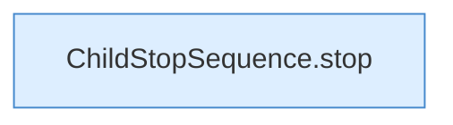

[[00 Start]] › [[Child-Prozess]] › [[Stopp]] › [[FabricLauncherPlugin.stopProcess]] › [[FabricLauncherPlugin.stopProcess.Z1994.Teil3.Z2011]]

# FabricLauncherPlugin.stopProcess.Z1994.Teil3.Z2011



```knoten
ChildStopSequence.stop
  Stoppt `stop`. Ruft `signal`.
```

- Fortsetzung von `FabricLauncherPlugin.stopProcess.Z1994.Teil3`, Quellreihenfolge.
