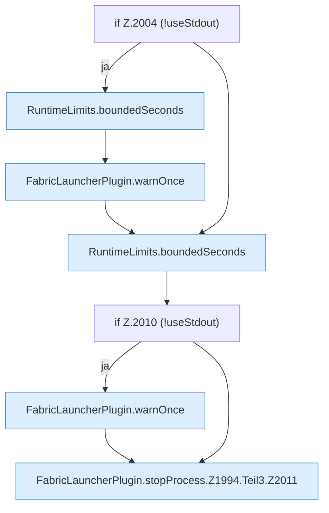

[[00 Start]] › [[Child-Prozess]] › [[Stopp]] › [[FabricLauncherPlugin.stopProcess]] › [[FabricLauncherPlugin.stopProcess.Z1994.Teil3]]

# FabricLauncherPlugin.stopProcess.Z1994.Teil3



```knoten
if Z.2004 (!useStdout)
  Zeile 2004: prüft `(!useStdout)`.
RuntimeLimits.boundedSeconds
  Dieser Teil macht hier einen einzelnen Schritt. Eine Ebene tiefer steht er genauer. Begrenzt `boundedSeconds`.
FabricLauncherPlugin.warnOnce
  Schreibt eine Warnung nur ein einziges Mal, damit das Protokoll nicht vollläuft. Warnt `warnOnce`.
if Z.2010 (!useStdout)
  Zeile 2010: prüft `(!useStdout)`.
FabricLauncherPlugin.stopProcess.Z1994.Teil3.Z2011
  Der Ablauf geht in [[Glossar#Zeile|Zeile]] 2011 weiter. Eine Ebene tiefer steht er genauer. Fortsetzung des Ablaufs ab Zeile 2011.
```

> [!knoten]- Was die Blöcke tun
> - **if Z.2004 (!useStdout)**: Zeile 2004: prüft `(!useStdout)`.
> - **RuntimeLimits.boundedSeconds**: Dieser Teil macht hier einen einzelnen Schritt. Eine Ebene tiefer steht er genauer. Begrenzt `boundedSeconds`.
> - **FabricLauncherPlugin.warnOnce**: Schreibt eine Warnung nur ein einziges Mal, damit das Protokoll nicht vollläuft. Warnt `warnOnce`.
> - **if Z.2010 (!useStdout)**: Zeile 2010: prüft `(!useStdout)`.
> - **FabricLauncherPlugin.stopProcess.Z1994.Teil3.Z2011**: Der Ablauf geht in [[Glossar#Zeile|Zeile]] 2011 weiter. Eine Ebene tiefer steht er genauer. Fortsetzung des Ablaufs ab Zeile 2011.

- Ein weiterer Abschnitt derselben Übersicht.
- Fortsetzung von `FabricLauncherPlugin.stopProcess.Z1994`.
