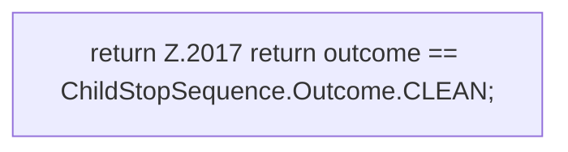

[[00 Start]] › [[Child-Prozess]] › [[Stopp]] › [[FabricLauncherPlugin.stopProcess]] › [[FabricLauncherPlugin.stopProcess.Z1994.Teil4]]

# FabricLauncherPlugin.stopProcess.Z1994.Teil4

- Fortsetzung von `FabricLauncherPlugin.stopProcess.Z1994`, Quellreihenfolge.
