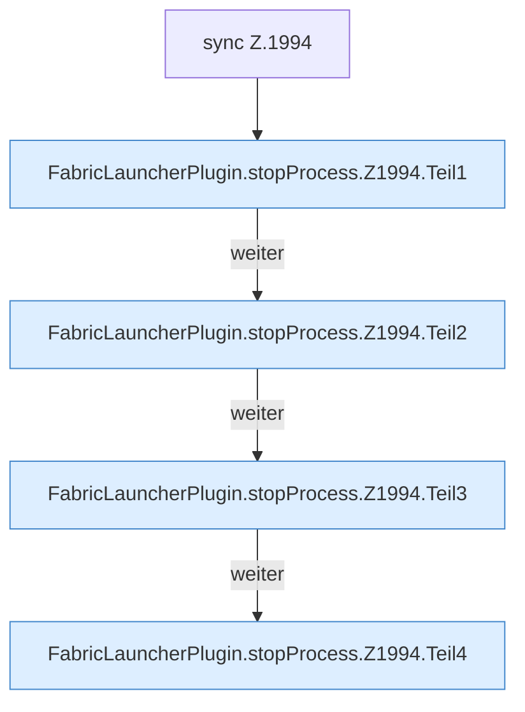

[[00 Start]] › [[Child-Prozess]] › [[Stopp]] › [[FabricLauncherPlugin.stopProcess]] › [[FabricLauncherPlugin.stopProcess.Z1994]]

# FabricLauncherPlugin.stopProcess.Z1994



```knoten
sync Z.1994
  Zeile 1994: synchronisierter Block.
FabricLauncherPlugin.stopProcess.Z1994.Teil1
  Abschnitt 1 dieses Ablaufs, in Quellreihenfolge.
FabricLauncherPlugin.stopProcess.Z1994.Teil2
  Abschnitt 2 dieses Ablaufs, in Quellreihenfolge.
FabricLauncherPlugin.stopProcess.Z1994.Teil3
  Abschnitt 3 dieses Ablaufs, in Quellreihenfolge.
FabricLauncherPlugin.stopProcess.Z1994.Teil4
  Abschnitt 4 dieses Ablaufs, in Quellreihenfolge.
```

- Fortsetzung von `FabricLauncherPlugin.stopProcess`, Quellreihenfolge.
