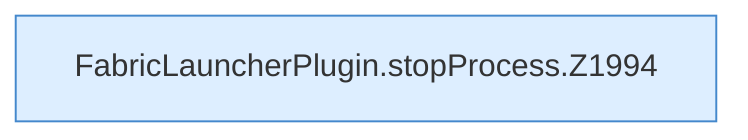
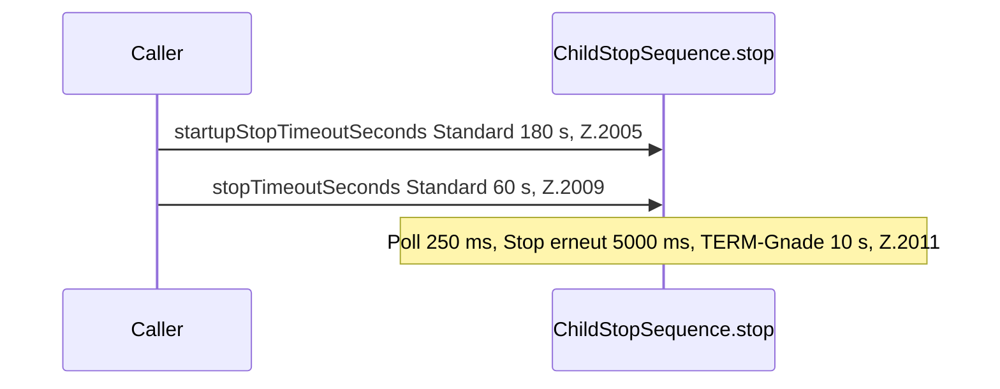

[[00 Start]] › [[Child-Prozess]] › [[Stopp]] › [[FabricLauncherPlugin.stopProcess]]

# FabricLauncherPlugin.stopProcess

`FabricLauncherPlugin.stopProcess(ChildSlot slot, long timeout, boolean useStdout)` [src/main/java/de/aichele/childlauncher/FabricLauncherPlugin.java:1994–2019](https://github.com/Sciddie/minecraft-serverhoster-plugin/blob/95b02b953b0b4c23673e900e021a7c3c844aa37d/src/main/java/de/aichele/childlauncher/FabricLauncherPlugin.java#L1994-L2019)



```knoten
FabricLauncherPlugin.stopProcess.Z1994
  Fortsetzung des Ablaufs ab Zeile 1994.
```



- `stopProcess` in `src/main/java/de/aichele/childlauncher/FabricLauncherPlugin.java`
