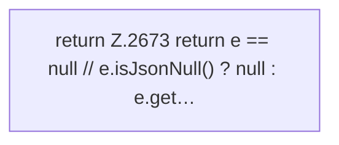

[[00 Start]] › [[Plugin-Kern]] › [[Host-Pfade]] › [[FabricLauncherPlugin.str]]

# FabricLauncherPlugin.str

`FabricLauncherPlugin.str(JsonObject o, String k)` [src/main/java/de/aichele/childlauncher/FabricLauncherPlugin.java:2673–2673](https://github.com/Sciddie/minecraft-serverhoster-plugin/blob/95b02b953b0b4c23673e900e021a7c3c844aa37d/src/main/java/de/aichele/childlauncher/FabricLauncherPlugin.java#L2673-L2673)



```knoten
return Z.2673 return e == null // e.isJsonNull() ? null : e.get…
  Hier endet die [[Glossar#Funktion|Funktion]] und liefert ein Ergebnis zurück. Das steht in [[Glossar#Zeile|Zeile]] 2673.
```

> [!knoten]- Was die Blöcke tun
> - **return Z.2673 return e == null // e.isJsonNull() ? null : e.get…**: Hier endet die [[Glossar#Funktion|Funktion]] und liefert ein Ergebnis zurück. Das steht in [[Glossar#Zeile|Zeile]] 2673.

- Das [[Glossar#Plugin|Plugin]] macht hier einen einzelnen Schritt. Eine Ebene tiefer steht er genauer.
