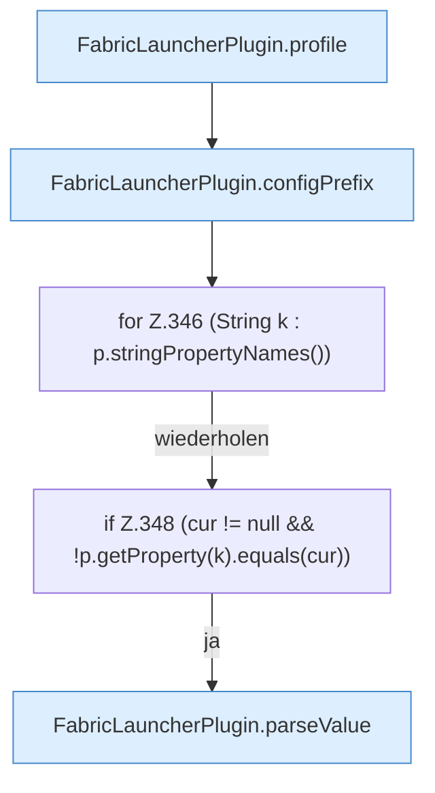

[[00 Start]] › [[Plugin-Kern]] › [[Properties]] › [[FabricLauncherPlugin.syncPropertiesEdit]] › [[FabricLauncherPlugin.syncPropertiesEdit.Teil1]]

# FabricLauncherPlugin.syncPropertiesEdit.Teil1



```knoten
FabricLauncherPlugin.profile
  `profile` in `FabricLauncherPlugin.java`.
FabricLauncherPlugin.configPrefix
  `configPrefix` in `FabricLauncherPlugin.java`.
for Z.346 (String k : p.stringPropertyNames())
  Zeile 346: Schleife `(String k : p.stringPropertyNames())`.
if Z.348 (cur != null && !p.getProperty(k).equals(cur))
  Zeile 348: prüft `(cur != null && !p.getProperty(k).equals(cur))`.
FabricLauncherPlugin.parseValue
  Wertet aus `parseValue`.
```

- Fortsetzung von `FabricLauncherPlugin.syncPropertiesEdit`, Quellreihenfolge.
