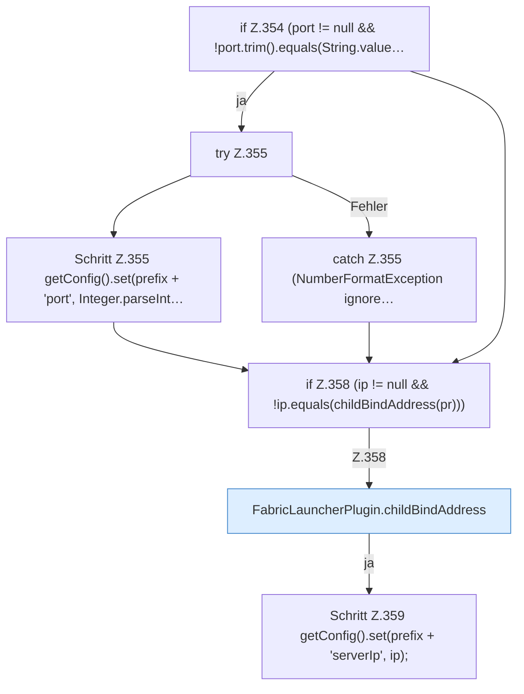

[[00 Start]] › [[Plugin-Kern]] › [[Properties]] › [[FabricLauncherPlugin.syncPropertiesEdit]] › [[FabricLauncherPlugin.syncPropertiesEdit.Teil2]]

# FabricLauncherPlugin.syncPropertiesEdit.Teil2



```knoten
if Z.354 (port != null && !port.trim().equals(String.value…
  Zeile 354: prüft `(port != null && !port.trim().equals(String.value…`.
try Z.355
  Zeile 355: Versuch. Der Fehlerpfad geht in catch.
Schritt Z.355 getConfig().set(prefix + 'port', Integer.parseInt…
  Zeile 355: liest die Config. `getConfig().set(prefix + 'port', Integer.parseInt…`
catch Z.355 (NumberFormatException ignore…
  Zeile 355: fängt (NumberFormatException ignore….
if Z.358 (ip != null && !ip.equals(childBindAddress(pr)))
  Zeile 358: prüft `(ip != null && !ip.equals(childBindAddress(pr)))`.
FabricLauncherPlugin.childBindAddress
  Die Adresse, unter der der [[Glossar#Spielserver|Spielserver]] erreichbar sein soll. Betrifft den Child `childBindAddress`. Ruft `effectiveBindAddress`, `hostBindAddress`.
Schritt Z.359 getConfig().set(prefix + 'serverIp', ip);
  Zeile 359: liest die Config. `getConfig().set(prefix + 'serverIp', ip);`
```

> [!knoten]- Was die Blöcke tun
> - **if Z.354 (port != null && !port.trim().equals(String.value…**: Zeile 354: prüft `(port != null && !port.trim().equals(String.value…`.
> - **try Z.355**: Zeile 355: Versuch. Der Fehlerpfad geht in catch.
> - **Schritt Z.355 getConfig().set(prefix + 'port', Integer.parseInt…**: Zeile 355: liest die Config. `getConfig().set(prefix + 'port', Integer.parseInt…`
> - **catch Z.355 (NumberFormatException ignore…**: Zeile 355: fängt (NumberFormatException ignore….
> - **if Z.358 (ip != null && !ip.equals(childBindAddress(pr)))**: Zeile 358: prüft `(ip != null && !ip.equals(childBindAddress(pr)))`.
> - **FabricLauncherPlugin.childBindAddress**: Die Adresse, unter der der [[Glossar#Spielserver|Spielserver]] erreichbar sein soll. Betrifft den Child `childBindAddress`. Ruft `effectiveBindAddress`, `hostBindAddress`.
> - **Schritt Z.359 getConfig().set(prefix + 'serverIp', ip);**: Zeile 359: liest die Config. `getConfig().set(prefix + 'serverIp', ip);`

- Ein weiterer Abschnitt derselben Übersicht.
- Fortsetzung von `FabricLauncherPlugin.syncPropertiesEdit`.
