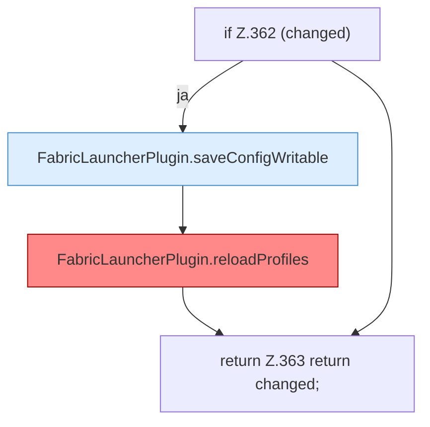

[[00 Start]] › [[Plugin-Kern]] › [[Properties]] › [[FabricLauncherPlugin.syncPropertiesEdit]] › [[FabricLauncherPlugin.syncPropertiesEdit.Teil3]]

# FabricLauncherPlugin.syncPropertiesEdit.Teil3

- Fortsetzung von `FabricLauncherPlugin.syncPropertiesEdit`, Quellreihenfolge.
