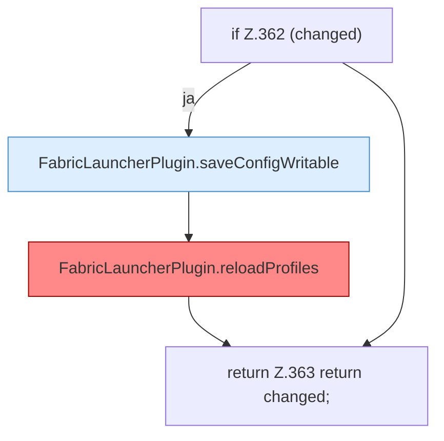

[[00 Start]] › [[Plugin-Kern]] › [[Properties]] › [[FabricLauncherPlugin.syncPropertiesEdit]] › [[FabricLauncherPlugin.syncPropertiesEdit.Teil3]]

# FabricLauncherPlugin.syncPropertiesEdit.Teil3



```knoten
if Z.362 (changed)
  Zeile 362: prüft `(changed)`.
FabricLauncherPlugin.saveConfigWritable
  Speichert `saveConfigWritable`. Ruft `makeWritable`.
FabricLauncherPlugin.reloadProfiles
  `Profiles.load`, danach nur `getFirst()`. Befund: angemeldet aber nicht umgesetzt (sicher).
return Z.363 return changed;
  Zeile 363: Rückgabe `return changed;`.
```

- Fortsetzung von `FabricLauncherPlugin.syncPropertiesEdit`, Quellreihenfolge.
