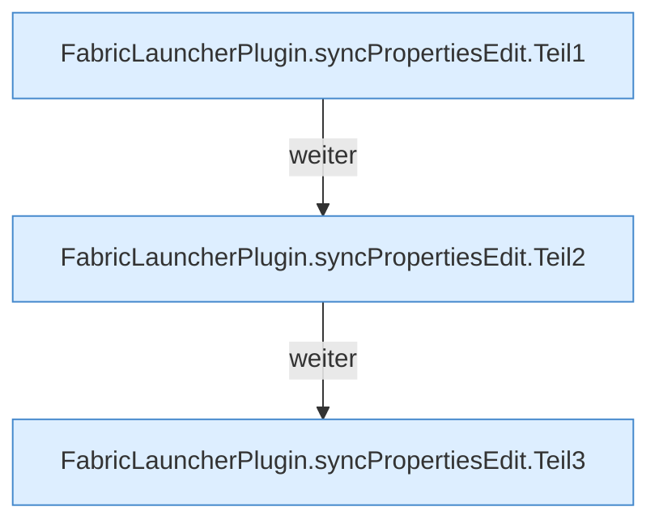

[[00 Start]] › [[Plugin-Kern]] › [[Properties]] › [[FabricLauncherPlugin.syncPropertiesEdit]]

# FabricLauncherPlugin.syncPropertiesEdit

`FabricLauncherPlugin.syncPropertiesEdit(String id, java.util.Properties p)` [src/main/java/de/aichele/childlauncher/FabricLauncherPlugin.java:342–364](https://github.com/Sciddie/minecraft-serverhoster-plugin/blob/95b02b953b0b4c23673e900e021a7c3c844aa37d/src/main/java/de/aichele/childlauncher/FabricLauncherPlugin.java#L342-L364)



```knoten
FabricLauncherPlugin.syncPropertiesEdit.Teil1
  Ein weiterer Abschnitt derselben Übersicht. Im [[Glossar#Quelltext|Quelltext]] heißt das `Teil1`.
FabricLauncherPlugin.syncPropertiesEdit.Teil2
  Ein weiterer Abschnitt derselben Übersicht. Im [[Glossar#Quelltext|Quelltext]] heißt das `Teil2`.
FabricLauncherPlugin.syncPropertiesEdit.Teil3
  Ein weiterer Abschnitt derselben Übersicht. Im [[Glossar#Quelltext|Quelltext]] heißt das `Teil3`.
```

> [!knoten]- Was die Blöcke tun
> - **FabricLauncherPlugin.syncPropertiesEdit.Teil1**: Ein weiterer Abschnitt derselben Übersicht. Im [[Glossar#Quelltext|Quelltext]] heißt das `Teil1`.
> - **FabricLauncherPlugin.syncPropertiesEdit.Teil2**: Ein weiterer Abschnitt derselben Übersicht. Im [[Glossar#Quelltext|Quelltext]] heißt das `Teil2`.
> - **FabricLauncherPlugin.syncPropertiesEdit.Teil3**: Ein weiterer Abschnitt derselben Übersicht. Im [[Glossar#Quelltext|Quelltext]] heißt das `Teil3`.

- Das [[Glossar#Plugin|Plugin]] gleicht ab die Eigenschaften die Bearbeitung.
