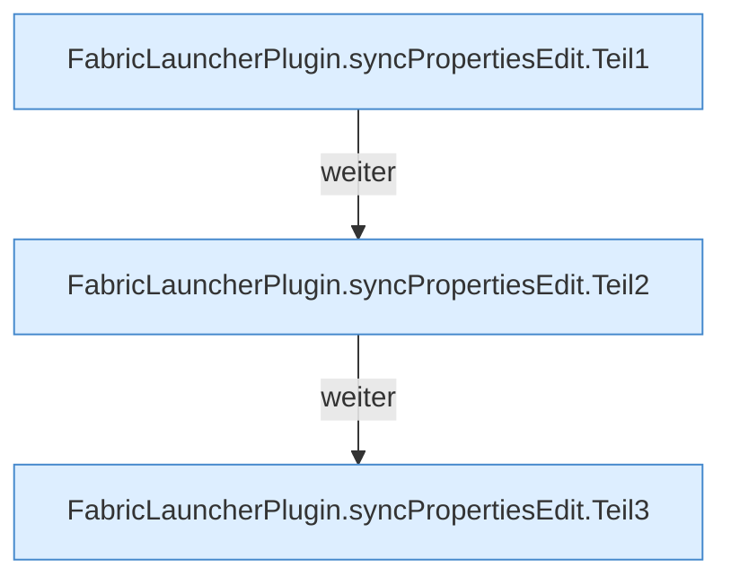

[[00 Start]] › [[Plugin-Kern]] › [[Properties]] › [[FabricLauncherPlugin.syncPropertiesEdit]]

# FabricLauncherPlugin.syncPropertiesEdit

`FabricLauncherPlugin.syncPropertiesEdit(String id, java.util.Properties p)` [src/main/java/de/aichele/childlauncher/FabricLauncherPlugin.java:342–364](https://github.com/Sciddie/minecraft-serverhoster-plugin/blob/95b02b953b0b4c23673e900e021a7c3c844aa37d/src/main/java/de/aichele/childlauncher/FabricLauncherPlugin.java#L342-L364)

- `syncPropertiesEdit` in `src/main/java/de/aichele/childlauncher/FabricLauncherPlugin.java`
