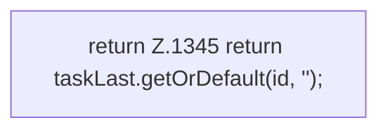

[[00 Start]] › [[Zeitplaene]] › [[Tasks]] › [[FabricLauncherPlugin.taskLast]]

# FabricLauncherPlugin.taskLast

`FabricLauncherPlugin.taskLast(String id)` [src/main/java/de/aichele/childlauncher/FabricLauncherPlugin.java:1345–1345](https://github.com/Sciddie/minecraft-serverhoster-plugin/blob/95b02b953b0b4c23673e900e021a7c3c844aa37d/src/main/java/de/aichele/childlauncher/FabricLauncherPlugin.java#L1345-L1345)



```knoten
return Z.1345 return taskLast.getOrDefault(id, '');
  Zeile 1345: Rückgabe `return taskLast.getOrDefault(id, '');`.
```

- `taskLast` in `src/main/java/de/aichele/childlauncher/FabricLauncherPlugin.java`
