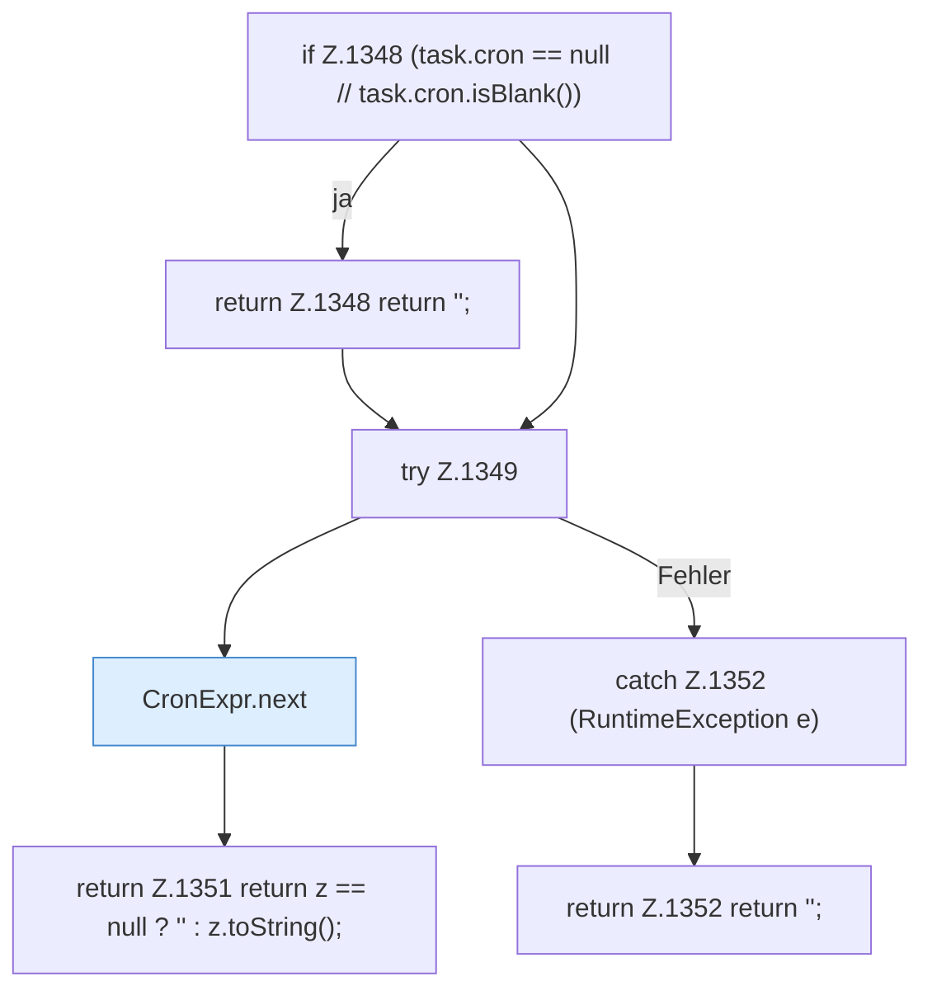

[[00 Start]] › [[Zeitplaene]] › [[Tasks]] › [[FabricLauncherPlugin.taskNext]]

# FabricLauncherPlugin.taskNext

`FabricLauncherPlugin.taskNext(TaskDef task)` [src/main/java/de/aichele/childlauncher/FabricLauncherPlugin.java:1347–1353](https://github.com/Sciddie/minecraft-serverhoster-plugin/blob/95b02b953b0b4c23673e900e021a7c3c844aa37d/src/main/java/de/aichele/childlauncher/FabricLauncherPlugin.java#L1347-L1353)

- `taskNext` in `src/main/java/de/aichele/childlauncher/FabricLauncherPlugin.java`
