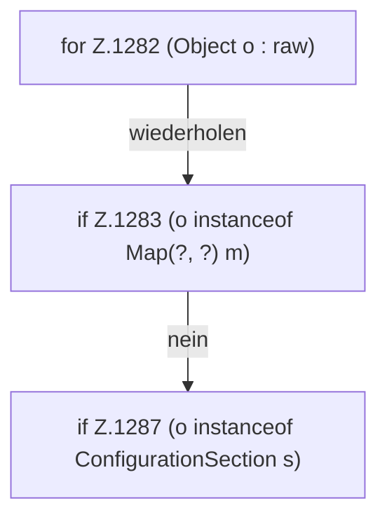

[[00 Start]] › [[Zeitplaene]] › [[Tasks]] › [[FabricLauncherPlugin.tasks]] › [[FabricLauncherPlugin.tasks.Z1282]]

# FabricLauncherPlugin.tasks.Z1282



```knoten
for Z.1282 (Object o : raw)
  Zeile 1282: Schleife `(Object o : raw)`.
if Z.1283 (o instanceof Map(?, ?) m)
  Zeile 1283: prüft `(o instanceof Map(?, ?) m)`.
if Z.1287 (o instanceof ConfigurationSection s)
  Zeile 1287: prüft `(o instanceof ConfigurationSection s)`.
```

- Fortsetzung von `FabricLauncherPlugin.tasks`, Quellreihenfolge.
