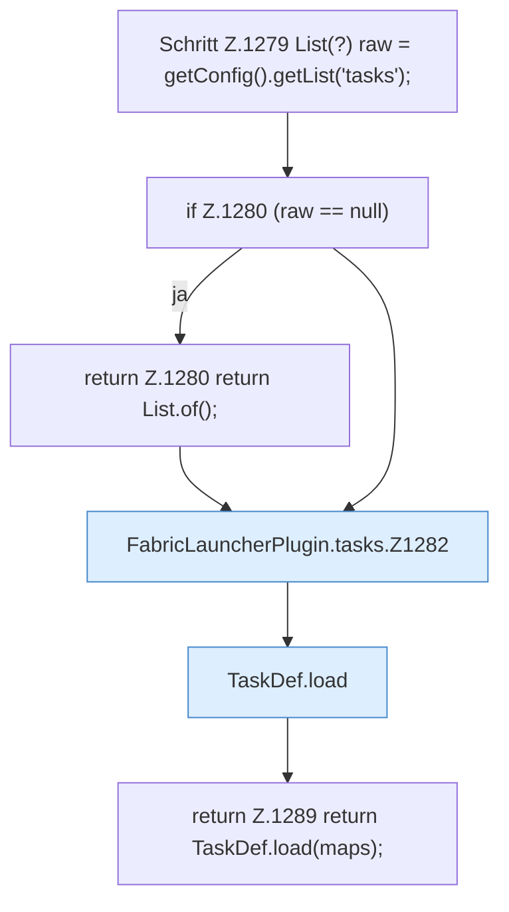

[[00 Start]] › [[Zeitplaene]] › [[Tasks]] › [[FabricLauncherPlugin.tasks]]

# FabricLauncherPlugin.tasks

`FabricLauncherPlugin.tasks()` [src/main/java/de/aichele/childlauncher/FabricLauncherPlugin.java:1278–1290](https://github.com/Sciddie/minecraft-serverhoster-plugin/blob/95b02b953b0b4c23673e900e021a7c3c844aa37d/src/main/java/de/aichele/childlauncher/FabricLauncherPlugin.java#L1278-L1290)



```knoten
Schritt Z.1279 List(?) raw = getConfig().getList('tasks');
  Ein einzelner Arbeitsschritt, ohne eine weitere eigene [[Glossar#Funktion|Funktion]] aufzurufen. Das steht in [[Glossar#Zeile|Zeile]] 1279.
if Z.1280 (raw == null)
  Hier fällt eine Entscheidung. Nur wenn sie zutrifft, geht es den Ja-Weg weiter. Das steht in [[Glossar#Zeile|Zeile]] 1280.
return Z.1280 return List.of();
  Hier endet die [[Glossar#Funktion|Funktion]] und liefert ein Ergebnis zurück. Das steht in [[Glossar#Zeile|Zeile]] 1280.
FabricLauncherPlugin.tasks.Z1282
  Der Ablauf geht in [[Glossar#Zeile|Zeile]] 1282 weiter. Eine Ebene tiefer steht er genauer. Im [[Glossar#Quelltext|Quelltext]] heißt das `Z1282`.
TaskDef.load
  Dieser Teil lädt das. Im [[Glossar#Quelltext|Quelltext]] heißt das `load`.
return Z.1289 return TaskDef.load(maps);
  Hier endet die [[Glossar#Funktion|Funktion]] und liefert ein Ergebnis zurück. Das steht in [[Glossar#Zeile|Zeile]] 1289.
```

> [!knoten]- Was die Blöcke tun
> - **Schritt Z.1279 List(?) raw = getConfig().getList('tasks');**: Ein einzelner Arbeitsschritt, ohne eine weitere eigene [[Glossar#Funktion|Funktion]] aufzurufen. Das steht in [[Glossar#Zeile|Zeile]] 1279.
> - **if Z.1280 (raw == null)**: Hier fällt eine Entscheidung. Nur wenn sie zutrifft, geht es den Ja-Weg weiter. Das steht in [[Glossar#Zeile|Zeile]] 1280.
> - **return Z.1280 return List.of();**: Hier endet die [[Glossar#Funktion|Funktion]] und liefert ein Ergebnis zurück. Das steht in [[Glossar#Zeile|Zeile]] 1280.
> - **FabricLauncherPlugin.tasks.Z1282**: Der Ablauf geht in [[Glossar#Zeile|Zeile]] 1282 weiter. Eine Ebene tiefer steht er genauer. Im [[Glossar#Quelltext|Quelltext]] heißt das `Z1282`.
> - **TaskDef.load**: Dieser Teil lädt das. Im [[Glossar#Quelltext|Quelltext]] heißt das `load`.
> - **return Z.1289 return TaskDef.load(maps);**: Hier endet die [[Glossar#Funktion|Funktion]] und liefert ein Ergebnis zurück. Das steht in [[Glossar#Zeile|Zeile]] 1289.

- Das [[Glossar#Plugin|Plugin]] macht hier einen einzelnen Schritt. Eine Ebene tiefer steht er genauer.
