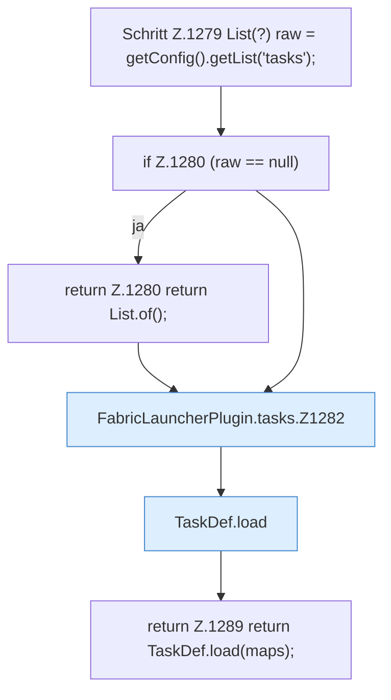

[[00 Start]] › [[Zeitplaene]] › [[Tasks]] › [[FabricLauncherPlugin.tasks]]

# FabricLauncherPlugin.tasks

`FabricLauncherPlugin.tasks()` [src/main/java/de/aichele/childlauncher/FabricLauncherPlugin.java:1278–1290](https://github.com/Sciddie/minecraft-serverhoster-plugin/blob/95b02b953b0b4c23673e900e021a7c3c844aa37d/src/main/java/de/aichele/childlauncher/FabricLauncherPlugin.java#L1278-L1290)



```knoten
Schritt Z.1279 List(?) raw = getConfig().getList('tasks');
  Zeile 1279: liest die Config. `List(?) raw = getConfig().getList('tasks');`
if Z.1280 (raw == null)
  Zeile 1280: prüft `(raw == null)`.
return Z.1280 return List.of();
  Zeile 1280: Rückgabe `return List.of();`.
FabricLauncherPlugin.tasks.Z1282
  Fortsetzung des Ablaufs ab Zeile 1282.
TaskDef.load
  Lädt `load`. Ruft `str`, `TaskDef`.
return Z.1289 return TaskDef.load(maps);
  Zeile 1289: Rückgabe `return TaskDef.load(maps);`.
```

- `tasks` in `src/main/java/de/aichele/childlauncher/FabricLauncherPlugin.java`
