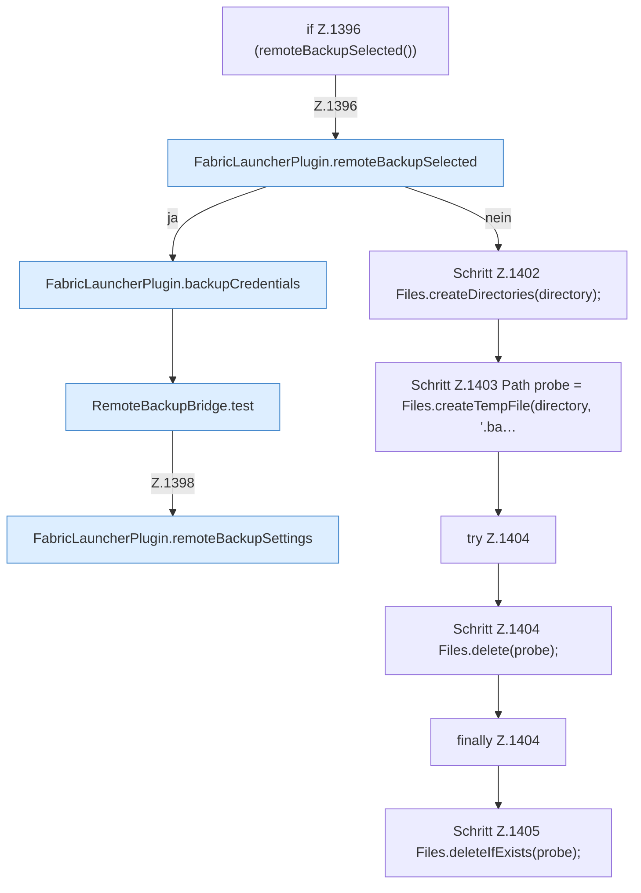

[[00 Start]] › [[Backup]] › [[Backup-Lauf]] › [[FabricLauncherPlugin.testBackup]] › [[FabricLauncherPlugin.testBackup.Z1396]]

# FabricLauncherPlugin.testBackup.Z1396

- Fortsetzung von `FabricLauncherPlugin.testBackup`, Quellreihenfolge.
