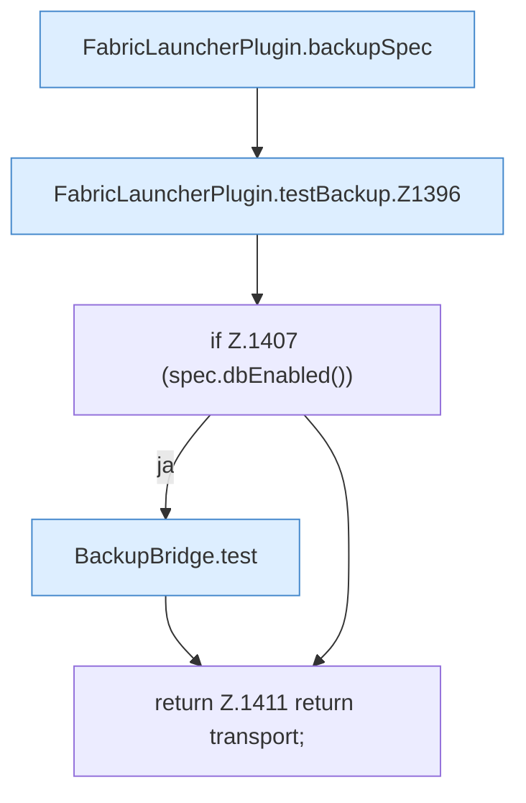

[[00 Start]] › [[Backup]] › [[Backup-Lauf]] › [[FabricLauncherPlugin.testBackup]]

# FabricLauncherPlugin.testBackup

`FabricLauncherPlugin.testBackup()` [src/main/java/de/aichele/childlauncher/FabricLauncherPlugin.java:1393–1412](https://github.com/Sciddie/minecraft-serverhoster-plugin/blob/95b02b953b0b4c23673e900e021a7c3c844aa37d/src/main/java/de/aichele/childlauncher/FabricLauncherPlugin.java#L1393-L1412)



```knoten
FabricLauncherPlugin.backupSpec
  Das [[Glossar#Plugin|Plugin]] sichert die Vorgabe. Im [[Glossar#Quelltext|Quelltext]] heißt das `backupSpec`.
FabricLauncherPlugin.testBackup.Z1396
  Der Ablauf geht in [[Glossar#Zeile|Zeile]] 1396 weiter. Eine Ebene tiefer steht er genauer. Im [[Glossar#Quelltext|Quelltext]] heißt das `Z1396`.
if Z.1407 (spec.dbEnabled())
  Hier fällt eine Entscheidung. Nur wenn sie zutrifft, geht es den Ja-Weg weiter. Das steht in [[Glossar#Zeile|Zeile]] 1407.
BackupBridge.test
  Die Sicherung auf diesem Rechner prüft das. Im [[Glossar#Quelltext|Quelltext]] heißt das `test`.
return Z.1411 return transport;
  Hier endet die [[Glossar#Funktion|Funktion]] und liefert ein Ergebnis zurück. Das steht in [[Glossar#Zeile|Zeile]] 1411.
```

> [!knoten]- Was die Blöcke tun
> - **FabricLauncherPlugin.backupSpec**: Das [[Glossar#Plugin|Plugin]] sichert die Vorgabe. Im [[Glossar#Quelltext|Quelltext]] heißt das `backupSpec`.
> - **FabricLauncherPlugin.testBackup.Z1396**: Der Ablauf geht in [[Glossar#Zeile|Zeile]] 1396 weiter. Eine Ebene tiefer steht er genauer. Im [[Glossar#Quelltext|Quelltext]] heißt das `Z1396`.
> - **if Z.1407 (spec.dbEnabled())**: Hier fällt eine Entscheidung. Nur wenn sie zutrifft, geht es den Ja-Weg weiter. Das steht in [[Glossar#Zeile|Zeile]] 1407.
> - **BackupBridge.test**: Die Sicherung auf diesem Rechner prüft das. Im [[Glossar#Quelltext|Quelltext]] heißt das `test`.
> - **return Z.1411 return transport;**: Hier endet die [[Glossar#Funktion|Funktion]] und liefert ein Ergebnis zurück. Das steht in [[Glossar#Zeile|Zeile]] 1411.

- Das [[Glossar#Plugin|Plugin]] prüft die [[Glossar#Sicherungskopie|Sicherungskopie]].
