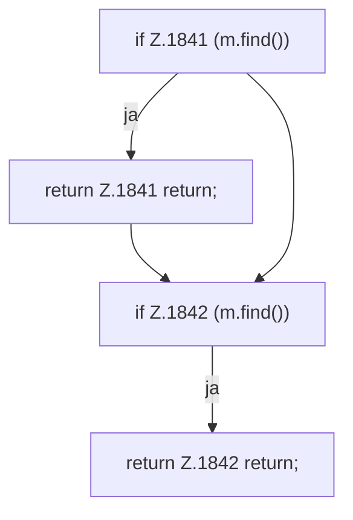

[[00 Start]] › [[Child-Prozess]] › [[Pipe-Watch]] › [[FabricLauncherPlugin.trackPlayers]] › [[FabricLauncherPlugin.trackPlayers.Teil1]]

# FabricLauncherPlugin.trackPlayers.Teil1



```knoten
if Z.1841 (m.find())
  Zeile 1841: prüft `(m.find())`.
return Z.1841 return;
  Zeile 1841: Rückgabe `return;`.
if Z.1842 (m.find())
  Zeile 1842: prüft `(m.find())`.
return Z.1842 return;
  Zeile 1842: Rückgabe `return;`.
```

- Fortsetzung von `FabricLauncherPlugin.trackPlayers`, Quellreihenfolge.
