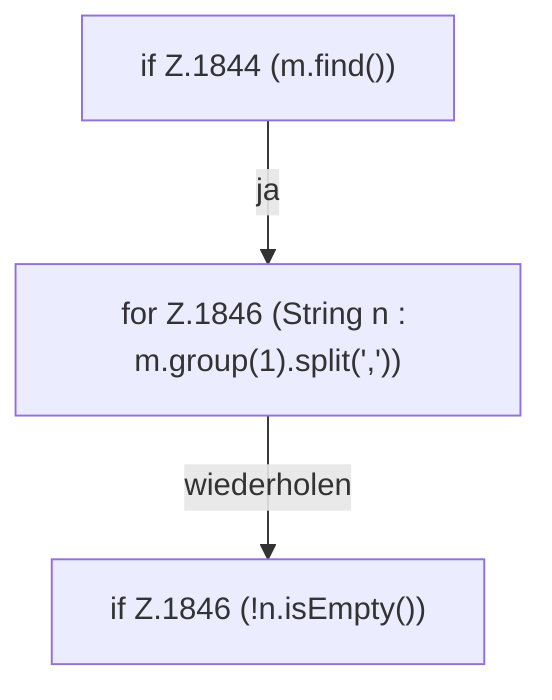

[[00 Start]] › [[Child-Prozess]] › [[Pipe-Watch]] › [[FabricLauncherPlugin.trackPlayers]] › [[FabricLauncherPlugin.trackPlayers.Teil2]]

# FabricLauncherPlugin.trackPlayers.Teil2



```knoten
if Z.1844 (m.find())
  Zeile 1844: prüft `(m.find())`.
for Z.1846 (String n : m.group(1).split(','))
  Zeile 1846: Schleife `(String n : m.group(1).split(','))`.
if Z.1846 (!n.isEmpty())
  Zeile 1846: prüft `(!n.isEmpty())`.
```

> [!knoten]- Was die Blöcke tun
> - **if Z.1844 (m.find())**: Zeile 1844: prüft `(m.find())`.
> - **for Z.1846 (String n : m.group(1).split(','))**: Zeile 1846: Schleife `(String n : m.group(1).split(','))`.
> - **if Z.1846 (!n.isEmpty())**: Zeile 1846: prüft `(!n.isEmpty())`.

- Ein weiterer Abschnitt derselben Übersicht.
- Fortsetzung von `FabricLauncherPlugin.trackPlayers`.
