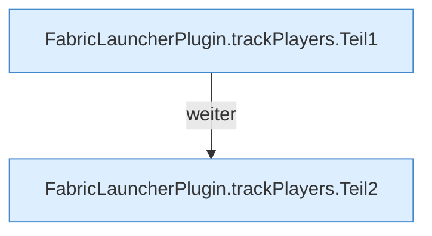

[[00 Start]] › [[Child-Prozess]] › [[Pipe-Watch]] › [[FabricLauncherPlugin.trackPlayers]]

# FabricLauncherPlugin.trackPlayers

`FabricLauncherPlugin.trackPlayers(ChildSlot slot, String line)` [src/main/java/de/aichele/childlauncher/FabricLauncherPlugin.java:1840–1848](https://github.com/Sciddie/minecraft-serverhoster-plugin/blob/95b02b953b0b4c23673e900e021a7c3c844aa37d/src/main/java/de/aichele/childlauncher/FabricLauncherPlugin.java#L1840-L1848)



```knoten
FabricLauncherPlugin.trackPlayers.Teil1
  Ein weiterer Abschnitt derselben Übersicht. Im [[Glossar#Quelltext|Quelltext]] heißt das `Teil1`.
FabricLauncherPlugin.trackPlayers.Teil2
  Ein weiterer Abschnitt derselben Übersicht. Im [[Glossar#Quelltext|Quelltext]] heißt das `Teil2`.
```

> [!knoten]- Was die Blöcke tun
> - **FabricLauncherPlugin.trackPlayers.Teil1**: Ein weiterer Abschnitt derselben Übersicht. Im [[Glossar#Quelltext|Quelltext]] heißt das `Teil1`.
> - **FabricLauncherPlugin.trackPlayers.Teil2**: Ein weiterer Abschnitt derselben Übersicht. Im [[Glossar#Quelltext|Quelltext]] heißt das `Teil2`.

- Merkt sich, welche [[Glossar#Spieler|Spieler]] gerade auf dem [[Glossar#Spielserver|Spielserver]] sind.
