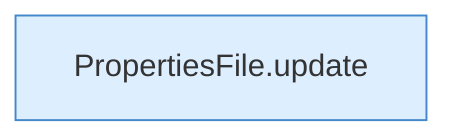

[[00 Start]] › [[Plugin-Kern]] › [[Properties]] › [[FabricLauncherPlugin.updateProperties]]

# FabricLauncherPlugin.updateProperties

`FabricLauncherPlugin.updateProperties(Path f, Map<String, String> force, Map<String, String> defaults)` [src/main/java/de/aichele/childlauncher/FabricLauncherPlugin.java:2624–2626](https://github.com/Sciddie/minecraft-serverhoster-plugin/blob/95b02b953b0b4c23673e900e021a7c3c844aa37d/src/main/java/de/aichele/childlauncher/FabricLauncherPlugin.java#L2624-L2626)



```knoten
PropertiesFile.update
  Aktualisiert `update`.
```

- `updateProperties` in `src/main/java/de/aichele/childlauncher/FabricLauncherPlugin.java`
