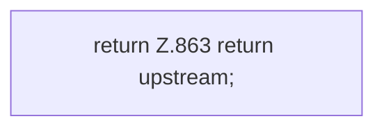

[[00 Start]] › [[Plugin-Kern]] › [[Host-Pfade]] › [[FabricLauncherPlugin.upstream]]

# FabricLauncherPlugin.upstream

`FabricLauncherPlugin.upstream()` [src/main/java/de/aichele/childlauncher/FabricLauncherPlugin.java:863–863](https://github.com/Sciddie/minecraft-serverhoster-plugin/blob/95b02b953b0b4c23673e900e021a7c3c844aa37d/src/main/java/de/aichele/childlauncher/FabricLauncherPlugin.java#L863-L863)

- `upstream` in `src/main/java/de/aichele/childlauncher/FabricLauncherPlugin.java`
- Befund: toter Code, wahrscheinlich. src/main/java/de/aichele/childlauncher/FabricLauncherPlugin.java:863–863 kein Produktionsaufruf im Aufrufgraph
