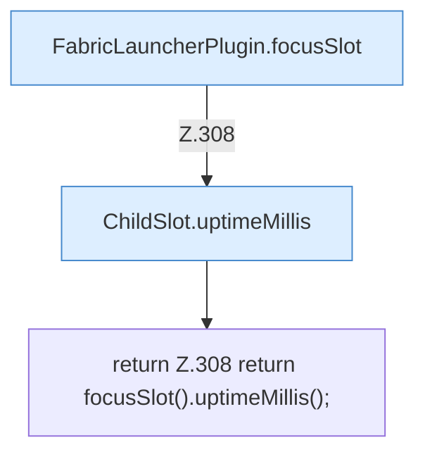

[[00 Start]] › [[Plugin-Kern]] › [[Slot-Status]] › [[FabricLauncherPlugin.uptimeMillis()]]

# FabricLauncherPlugin.uptimeMillis()

`FabricLauncherPlugin.uptimeMillis()` [src/main/java/de/aichele/childlauncher/FabricLauncherPlugin.java:308–308](https://github.com/Sciddie/minecraft-serverhoster-plugin/blob/95b02b953b0b4c23673e900e021a7c3c844aa37d/src/main/java/de/aichele/childlauncher/FabricLauncherPlugin.java#L308-L308)

- `uptimeMillis` in `src/main/java/de/aichele/childlauncher/FabricLauncherPlugin.java`
- Befund: toter Code, sicher. src/main/java/de/aichele/childlauncher/FabricLauncherPlugin.java:308–308 kein Aufruf, kein Treffer in plugin.yml/UI/Strings
