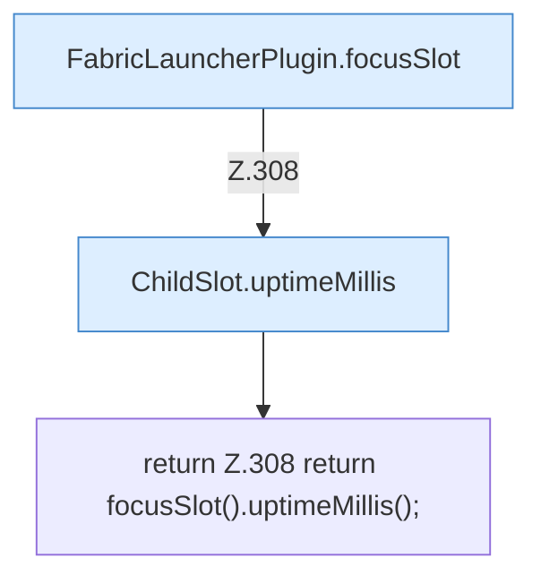

[[00 Start]] › [[Plugin-Kern]] › [[Slot-Status]] › [[FabricLauncherPlugin.uptimeMillis()]]

# FabricLauncherPlugin.uptimeMillis()

`FabricLauncherPlugin.uptimeMillis()` [src/main/java/de/aichele/childlauncher/FabricLauncherPlugin.java:308–308](https://github.com/Sciddie/minecraft-serverhoster-plugin/blob/95b02b953b0b4c23673e900e021a7c3c844aa37d/src/main/java/de/aichele/childlauncher/FabricLauncherPlugin.java#L308-L308)



```knoten
FabricLauncherPlugin.focusSlot
  Das [[Glossar#Plugin|Plugin]] liefert den [[Glossar#Platz|Platz]]. Im [[Glossar#Quelltext|Quelltext]] heißt das `focusSlot`.
ChildSlot.uptimeMillis
  Dieser Teil kümmert sich um die Zeit. Im [[Glossar#Quelltext|Quelltext]] heißt das `uptimeMillis`.
return Z.308 return focusSlot().uptimeMillis();
  Hier endet die [[Glossar#Funktion|Funktion]] und liefert ein Ergebnis zurück. Das steht in [[Glossar#Zeile|Zeile]] 308.
```

> [!knoten]- Was die Blöcke tun
> - **FabricLauncherPlugin.focusSlot**: Das [[Glossar#Plugin|Plugin]] liefert den [[Glossar#Platz|Platz]]. Im [[Glossar#Quelltext|Quelltext]] heißt das `focusSlot`.
> - **ChildSlot.uptimeMillis**: Dieser Teil kümmert sich um die Zeit. Im [[Glossar#Quelltext|Quelltext]] heißt das `uptimeMillis`.
> - **return Z.308 return focusSlot().uptimeMillis();**: Hier endet die [[Glossar#Funktion|Funktion]] und liefert ein Ergebnis zurück. Das steht in [[Glossar#Zeile|Zeile]] 308.

- Sagt, wie lange der [[Glossar#Spielserver|Spielserver]] schon läuft.
- Auffällig: im normalen Betrieb ruft das niemand auf. Das nennt man [[Glossar#Ungenutzt|Ungenutzt]].
