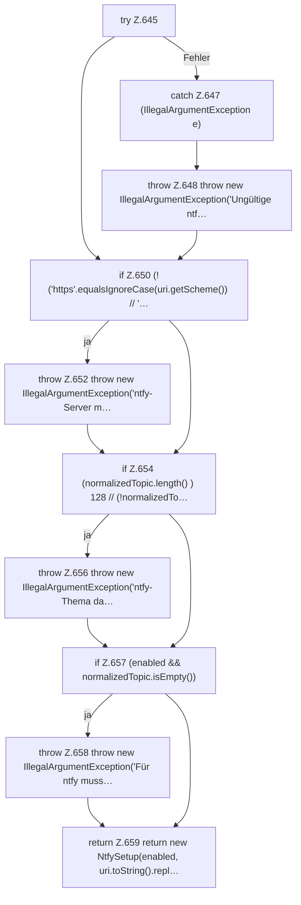

[[00 Start]] › [[Plugin-Kern]] › [[Setup]] › [[Setup-Dialog]] › [[FabricLauncherPlugin.validateNtfySetup]]

# FabricLauncherPlugin.validateNtfySetup

`FabricLauncherPlugin.validateNtfySetup(boolean enabled, String server, String topic)` [src/main/java/de/aichele/childlauncher/FabricLauncherPlugin.java:643–660](https://github.com/Sciddie/minecraft-serverhoster-plugin/blob/95b02b953b0b4c23673e900e021a7c3c844aa37d/src/main/java/de/aichele/childlauncher/FabricLauncherPlugin.java#L643-L660)



```knoten
try Z.645
  Zeile 645: Versuch. Der Fehlerpfad geht in catch.
catch Z.647 (IllegalArgumentException e)
  Zeile 647: fängt (IllegalArgumentException e).
throw Z.648 throw new IllegalArgumentException('Ungültige ntf…
  Zeile 648: Abbruch `throw new IllegalArgumentException('Ungültige ntf…`.
if Z.650 (!('https'.equalsIgnoreCase(uri.getScheme()) // '…
  Zeile 650: prüft `(!('https'.equalsIgnoreCase(uri.getScheme()) // '…`.
throw Z.652 throw new IllegalArgumentException('ntfy-Server m…
  Zeile 652: Abbruch `throw new IllegalArgumentException('ntfy-Server m…`.
if Z.654 (normalizedTopic.length() ) 128 // (!normalizedTo…
  Zeile 654: prüft `(normalizedTopic.length() ) 128 // (!normalizedTo…`.
throw Z.656 throw new IllegalArgumentException('ntfy-Thema da…
  Zeile 656: Abbruch `throw new IllegalArgumentException('ntfy-Thema da…`.
if Z.657 (enabled && normalizedTopic.isEmpty())
  Zeile 657: prüft `(enabled && normalizedTopic.isEmpty())`.
throw Z.658 throw new IllegalArgumentException('Für ntfy muss…
  Zeile 658: Abbruch `throw new IllegalArgumentException('Für ntfy muss…`.
return Z.659 return new NtfySetup(enabled, uri.toString().repl…
  Zeile 659: Rückgabe `return new NtfySetup(enabled, uri.toString().repl…`.
```

> [!knoten]- Was die Blöcke tun
> - **try Z.645**: Zeile 645: Versuch. Der Fehlerpfad geht in catch.
> - **catch Z.647 (IllegalArgumentException e)**: Zeile 647: fängt (IllegalArgumentException e).
> - **throw Z.648 throw new IllegalArgumentException('Ungültige ntf…**: Zeile 648: Abbruch `throw new IllegalArgumentException('Ungültige ntf…`.
> - **if Z.650 (!('https'.equalsIgnoreCase(uri.getScheme()) // '…**: Zeile 650: prüft `(!('https'.equalsIgnoreCase(uri.getScheme()) // '…`.
> - **throw Z.652 throw new IllegalArgumentException('ntfy-Server m…**: Zeile 652: Abbruch `throw new IllegalArgumentException('ntfy-Server m…`.
> - **if Z.654 (normalizedTopic.length() ) 128 // (!normalizedTo…**: Zeile 654: prüft `(normalizedTopic.length() ) 128 // (!normalizedTo…`.
> - **throw Z.656 throw new IllegalArgumentException('ntfy-Thema da…**: Zeile 656: Abbruch `throw new IllegalArgumentException('ntfy-Thema da…`.
> - **if Z.657 (enabled && normalizedTopic.isEmpty())**: Zeile 657: prüft `(enabled && normalizedTopic.isEmpty())`.
> - **throw Z.658 throw new IllegalArgumentException('Für ntfy muss…**: Zeile 658: Abbruch `throw new IllegalArgumentException('Für ntfy muss…`.
> - **return Z.659 return new NtfySetup(enabled, uri.toString().repl…**: Zeile 659: Rückgabe `return new NtfySetup(enabled, uri.toString().repl…`.

- Das [[Glossar#Plugin|Plugin]] prüft den Mitteilungsdienst die [[Glossar#Einrichtung|Einrichtung]].
- `validateNtfySetup` in `src/main/java/de/aichele/childlauncher/FabricLauncherPlugin.java`
