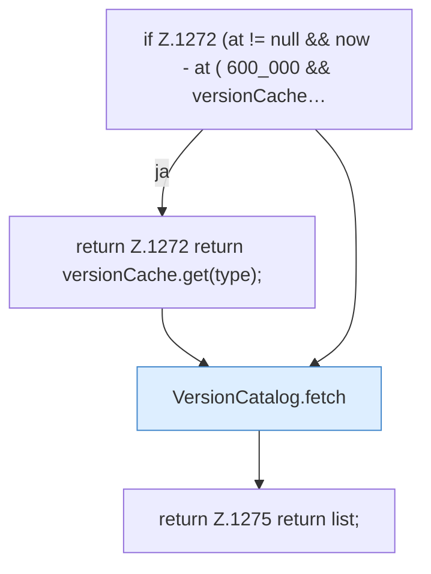

[[00 Start]] › [[Server-Anlage]] › [[Versionen]] › [[FabricLauncherPlugin.versions]]

# FabricLauncherPlugin.versions

`FabricLauncherPlugin.versions(String type)` [src/main/java/de/aichele/childlauncher/FabricLauncherPlugin.java:1269–1276](https://github.com/Sciddie/minecraft-serverhoster-plugin/blob/95b02b953b0b4c23673e900e021a7c3c844aa37d/src/main/java/de/aichele/childlauncher/FabricLauncherPlugin.java#L1269-L1276)

- `versions` in `src/main/java/de/aichele/childlauncher/FabricLauncherPlugin.java`
