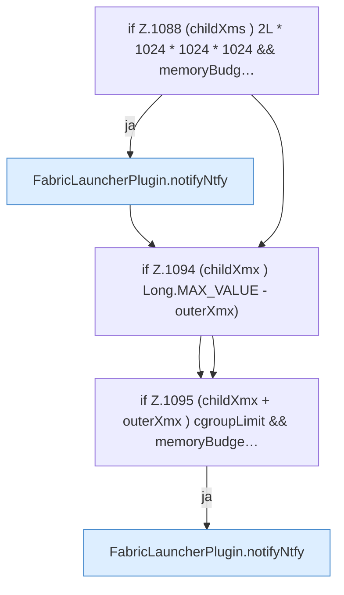

[[00 Start]] › [[Host-Betrieb]] › [[Speicher-Probe]] › [[FabricLauncherPlugin.warnHeapBudget]] › [[FabricLauncherPlugin.warnHeapBudget.Z1070.Teil2]]

# FabricLauncherPlugin.warnHeapBudget.Z1070.Teil2



```knoten
if Z.1088 (childXms ) 2L * 1024 * 1024 * 1024 && memoryBudg…
  Zeile 1088: prüft `(childXms ) 2L * 1024 * 1024 * 1024 && memoryBudg…`.
FabricLauncherPlugin.notifyNtfy
  Meldet `notifyNtfy`. Ruft `ntfySettings`, `backupCredentials`, `send`.
if Z.1094 (childXmx ) Long.MAX_VALUE - outerXmx)
  Zeile 1094: prüft `(childXmx ) Long.MAX_VALUE - outerXmx)`.
if Z.1095 (childXmx + outerXmx ) cgroupLimit && memoryBudge…
  Zeile 1095: prüft `(childXmx + outerXmx ) cgroupLimit && memoryBudge…`.
```

- Fortsetzung von `FabricLauncherPlugin.warnHeapBudget.Z1070`, Quellreihenfolge.
