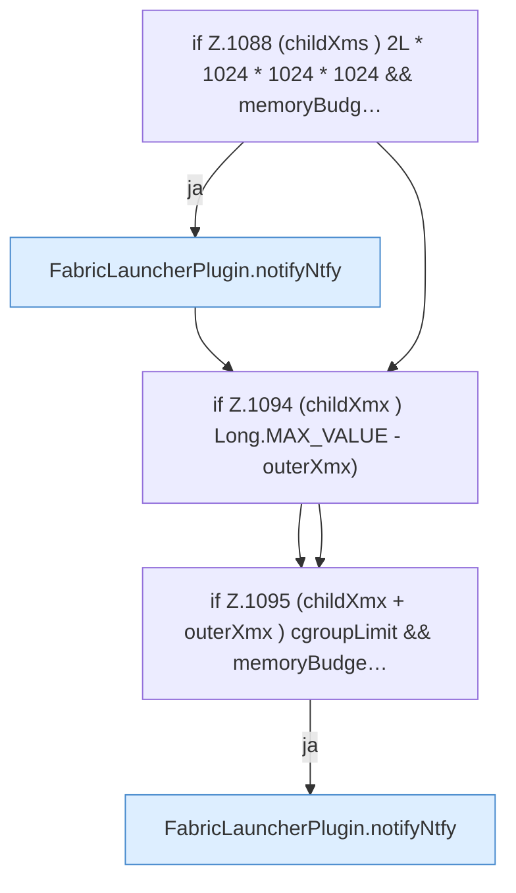

[[00 Start]] › [[Host-Betrieb]] › [[Speicher-Probe]] › [[FabricLauncherPlugin.warnHeapBudget]] › [[FabricLauncherPlugin.warnHeapBudget.Z1070.Teil2]]

# FabricLauncherPlugin.warnHeapBudget.Z1070.Teil2

- Fortsetzung von `FabricLauncherPlugin.warnHeapBudget.Z1070`, Quellreihenfolge.
